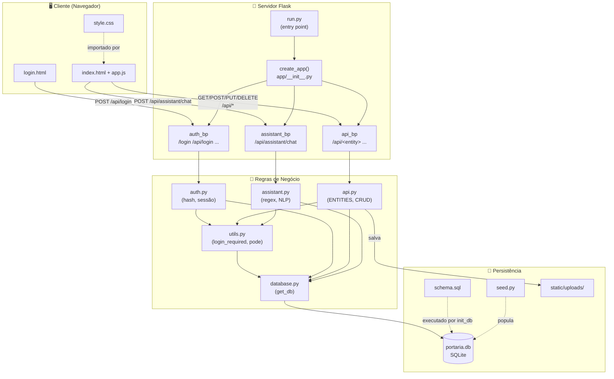
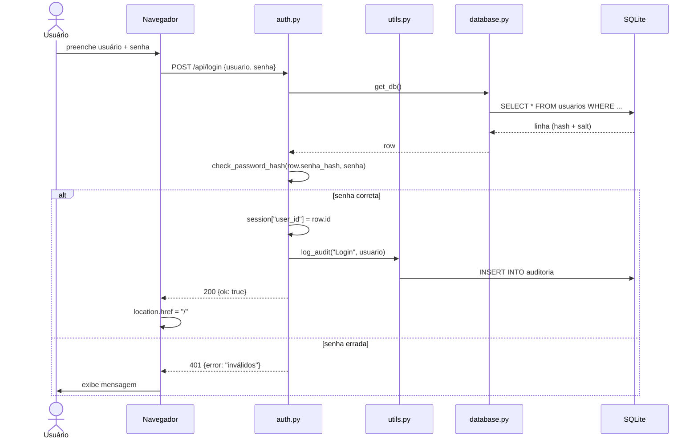
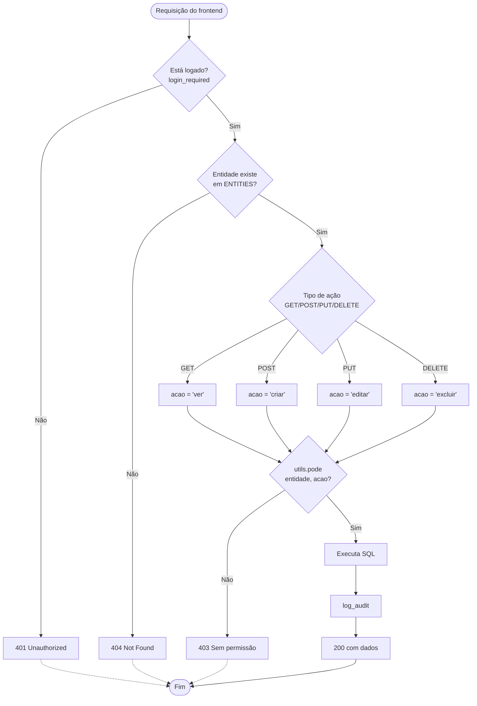
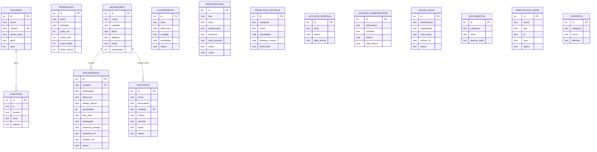
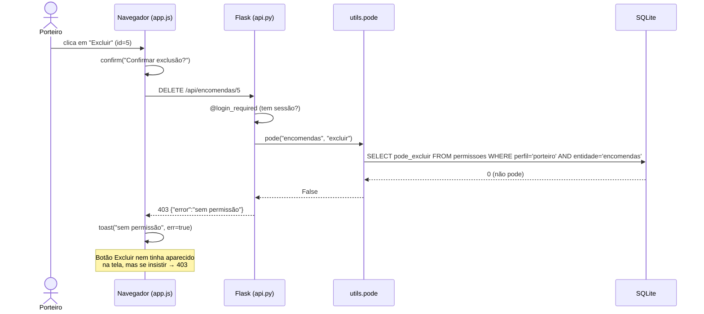
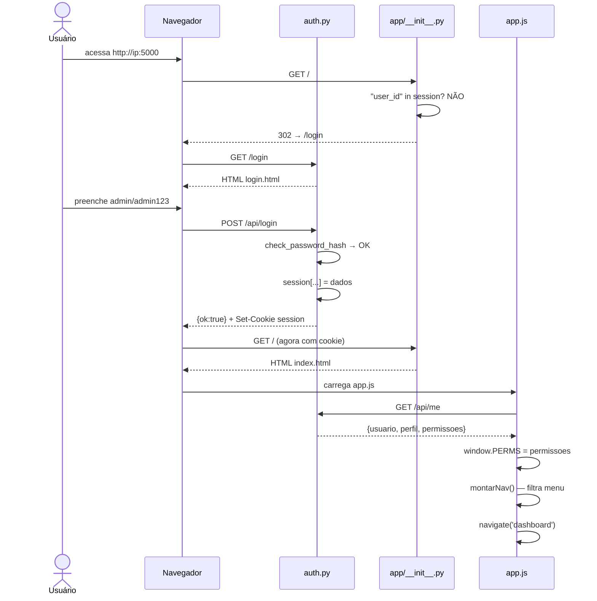

# sistema-condominio
# 📚 Documentação Completa — Sistema Portaria Inteligente

> Documentação técnica em português, com explicação em linguagem humana de **cada import, pasta, pacote, rota e função**, mais diagramas de arquitetura, fluxo e modelo de dados.

---

## 📑 Sumário

1. [Visão Geral](#1-visão-geral)
2. [Estrutura de Pastas](#2-estrutura-de-pastas)
3. [Diagrama de Arquitetura](#3-diagrama-de-arquitetura)
4. [Diagrama de Fluxo — Login](#4-diagrama-de-fluxo--login)
5. [Diagrama de Fluxo — CRUD e Permissões](#5-diagrama-de-fluxo--crud-e-permissões)
6. [Modelo de Dados (ERD)](#6-modelo-de-dados-erd)
7. [`requirements.txt`](#7-requirementstxt)
8. [`config.py`](#8-configpy)
9. [`run.py`](#9-runpy)
10. [`app/__init__.py`](#10-app__init__py)
11. [`app/database.py`](#11-appdatabasepy)
12. [`app/utils.py`](#12-apputilspy)
13. [`app/auth.py`](#13-appauthpy)
14. [`app/api.py`](#14-appapipy)
15. [`app/assistant.py`](#15-appassistantpy)
16. [`database/schema.sql`](#16-databaseschemasql)
17. [`database/seed.py`](#17-databaseseedpy)
18. [`templates/login.html`](#18-templatesloginhtml)
19. [`templates/index.html`](#19-templatesindexhtml)
20. [`static/css/style.css`](#20-staticcssstylecss)
21. [`static/js/app.js`](#21-staticjsappjs)
22. [Fluxo completo de uma requisição](#22-fluxo-completo-de-uma-requisição)
23. [Como adicionar um novo módulo](#23-como-adicionar-um-novo-módulo)
24. [Segurança aplicada](#24-segurança-aplicada)
25. [Glossário](#25-glossário)

---

## 1. Visão Geral

O **Sistema Portaria Inteligente** é uma aplicação web para gerenciar condomínios: visitantes, encomendas, manutenções, estoque, leituras de consumo, documentos, contatos e mais. Possui **login**, **controle de permissões granular por perfil** e um **assistente inteligente em linguagem natural**.

**Stack:**

| Camada | Tecnologia | Papel |
|---|---|---|
| Backend | Python + Flask | Servidor HTTP, rotas, regras de negócio |
| Banco de dados | SQLite | Persistência (arquivo `.db`) |
| Frontend | HTML + CSS + JavaScript puro | Interface SPA-like |
| Autenticação | Flask session + Werkzeug hash | Login com senha criptografada |
| IA | Regras em Python | Interpretação de linguagem natural |

**Principais padrões usados:**

- **Factory pattern** (`create_app()` em `app/__init__.py`)
- **Blueprint** do Flask — modularização por domínio (`auth`, `api`, `assistant`)
- **CRUD genérico** — um único endpoint atende 20+ entidades via dicionário `ENTITIES`
- **Permissões declarativas** — tabela `permissoes` + função `pode()` guarda toda requisição

---

## 2. Estrutura de Pastas

```
portaria/
│
├── run.py                        ← Ponto de entrada. Executa o servidor.
├── config.py                     ← Configurações (caminhos, chave secreta, uploads).
├── requirements.txt              ← Dependências Python.
│
├── app/                          ← Pacote principal da aplicação Flask.
│   ├── __init__.py               ← Fábrica `create_app()` + auto-seed.
│   ├── database.py               ← Conexão SQLite por requisição.
│   ├── utils.py                  ← Decorators de auth + função `pode()` + logs.
│   ├── auth.py                   ← Login, logout, /me, usuários, permissões.
│   ├── api.py                    ← CRUD genérico de 24 entidades + uploads.
│   └── assistant.py              ← Assistente em linguagem natural.
│
├── database/                     ← Tudo que é "banco de dados" fica aqui.
│   ├── schema.sql                ← DDL: criação de todas as tabelas.
│   ├── portaria.db               ← Arquivo SQLite (criado automaticamente).
│   └── seed.py                   ← Script opcional para popular usuários.
│
├── templates/                    ← HTML servido pelo Flask (Jinja2).
│   ├── login.html                ← Tela de login.
│   └── index.html                ← Aplicação principal (SPA).
│
└── static/                       ← Arquivos estáticos servidos diretamente.
    ├── css/
    │   └── style.css             ← Estilo global (dark theme).
    ├── js/
    │   └── app.js                ← Toda a lógica do frontend.
    └── uploads/                  ← Arquivos enviados pelo usuário.
```

**Convenções:**

- **Pacotes Python** = pastas com `__init__.py`
- **Blueprints** = arquivos dentro de `app/` registrados na fábrica
- **Tabelas** = 24 tabelas em `schema.sql`, uma por entidade de negócio
- **Config-driven** = adicionar módulo novo = uma entrada em `ENTITIES` (backend) + uma em `ENTITIES` (frontend)

---

## 3. Diagrama de Arquitetura



**Versão em texto (para quem não vê Mermaid):**

```
┌─────────────────────────────┐
│  NAVEGADOR (Cliente)        │
│  ┌────────────┐ ┌─────────┐ │
│  │ login.html │ │index.html│ │
│  └────────────┘ └────┬────┘ │
│       │              │      │
└───────┼──────────────┼──────┘
        │              │
        │ POST /api/login
        │              │ GET/POST/PUT/DELETE /api/*
        ▼              ▼
┌──────────────────────────────┐
│  FLASK (Servidor)            │
│  run.py → create_app()       │
│    ├── auth_bp               │
│    ├── api_bp                │
│    └── assistant_bp          │
└───────┬──────┬──────┬────────┘
        │      │      │
        ▼      ▼      ▼
    auth.py  api.py assistant.py
        │      │      │
        └──────┼──────┘
               │
               ▼
        utils.py (pode, login_required)
               │
               ▼
        database.py (get_db)
               │
               ▼
        ┌──────────────┐
        │ portaria.db  │ SQLite
        └──────────────┘
```

---

## 4. Diagrama de Fluxo — Login



---

## 5. Diagrama de Fluxo — CRUD e Permissões



---

## 6. Modelo de Dados (ERD)



> 💡 Todas as tabelas seguem o mesmo padrão de PK `id INTEGER PRIMARY KEY AUTOINCREMENT` e possuem índice na coluna mais consultada (`status`, `categoria`, `tipo`).

---

## 7. `requirements.txt`

```txt
Flask==3.0.3
Werkzeug==3.0.3
```

### O que é cada linha

| Linha | Pacote | Para que serve |
|---|---|---|
| `Flask==3.0.3` | Framework web | Fornece `Flask`, `Blueprint`, `request`, `jsonify`, `session`, `render_template`, `redirect`, `url_for`. É o **coração do servidor HTTP**. |
| `Werkzeug==3.0.3` | Utilitários WSGI | Vem junto com Flask. Usamos `generate_password_hash` e `check_password_hash` para **nunca guardar senha em texto puro**. |

**Por que versões fixas?** Para garantir que qualquer pessoa que rode `pip install -r requirements.txt` obtenha exatamente o mesmo comportamento. Sem `==`, uma atualização poderia quebrar o código.

---

## 8. `config.py`

```python
import os

BASE_DIR = os.path.abspath(os.path.dirname(__file__))

class Config:
    SECRET_KEY = os.environ.get("SECRET_KEY", "portaria-inteligente-2024-troque-em-producao")
    DATABASE = os.path.join(BASE_DIR, "database", "portaria.db")
    SCHEMA = os.path.join(BASE_DIR, "database", "schema.sql")
    UPLOAD_FOLDER = os.path.join(BASE_DIR, "static", "uploads")
    MAX_CONTENT_LENGTH = 16 * 1024 * 1024
    ALLOWED_EXTENSIONS = {"png", "jpg", "jpeg", "gif", "pdf", "doc", "docx", "xls", "xlsx", "txt", "dwg", "dxf"}
```

### Linha por linha

**`import os`**  
Importa o módulo padrão do Python que lida com **caminhos de arquivo** e **variáveis de ambiente**. Precisamos dele para montar caminhos absolutos (que funcionam em Windows, Linux e Mac) e para ler `SECRET_KEY` do ambiente.

**`BASE_DIR = os.path.abspath(os.path.dirname(__file__))`**  
Descobre o caminho absoluto da pasta onde este arquivo está. `__file__` = caminho deste `config.py`; `os.path.dirname(...)` = pasta dele; `abspath(...)` = converte para caminho completo (ex.: `D:\Projetos\python\sistema de portaria`). **Por que?** Para que `DATABASE`, `SCHEMA` e `UPLOAD_FOLDER` funcionem de qualquer pasta de onde o `python run.py` for executado.

**`class Config:`**  
Agrupa todas as configurações em uma classe. Flask aceita classes como config — `app.config.from_object(Config)` copia os atributos para o dicionário de configuração do app.

**`SECRET_KEY = os.environ.get(...)`**  
A chave usada para **assinar os cookies de sessão** (o `session` do Flask). Sem ela, o servidor não consegue validar se o cookie de login foi adulterado.  
- Se existir variável de ambiente `SECRET_KEY`, usa ela.  
- Senão, usa um valor default **apenas para desenvolvimento**.  
- **Em produção** deve-se definir `SECRET_KEY` via variável de ambiente.

**`DATABASE = os.path.join(BASE_DIR, "database", "portaria.db")`**  
Caminho completo do arquivo SQLite. `os.path.join` monta `...\database\portaria.db` no Windows e `.../database/portaria.db` no Linux. Esse caminho é usado por `app/database.py` em `sqlite3.connect(...)`.

**`SCHEMA = os.path.join(BASE_DIR, "database", "schema.sql")`**  
Caminho do arquivo `.sql` que cria as tabelas. Lido por `init_db()` em `app/database.py`.

**`UPLOAD_FOLDER = os.path.join(BASE_DIR, "static", "uploads")`**  
Pasta onde arquivos enviados pelo usuário (fotos de encomendas, PDFs de manuais) serão salvos. Também é servida em `/static/uploads/<arquivo>` pelo Flask.

**`MAX_CONTENT_LENGTH = 16 * 1024 * 1024`**  
16 MB em bytes. O Flask **rejeita automaticamente** uploads maiores com erro `413 Request Entity Too Large`. Proteção contra abuso.

**`ALLOWED_EXTENSIONS = {...}`**  
Whitelist de extensões permitidas para upload. Verificada por `allowed_file()` em `utils.py`. Sem essa lista, um usuário poderia subir um `.exe` ou `.php`. **Nunca** confie no `Content-Type` — confie na extensão e no contexto do servidor.

---

## 9. `run.py`

```python
from app import create_app

app = create_app()

if __name__ == "__main__":
    app.run(host="0.0.0.0", port=5000, debug=True)
```

### Linha por linha

**`from app import create_app`**  
Importa a **fábrica** de aplicação (função que monta o app do zero). A pasta `app/` tem `__init__.py` que define `create_app()`. Importar assim mantém o código do `run.py` **curto** e delega responsabilidades.

**`app = create_app()`**  
Chama a fábrica. Ela faz **tudo** internamente:
1. Cria `Flask(__name__)`.
2. Aplica `Config`.
3. Cria pasta `static/uploads`.
4. Roda `init_db()` (aplica `schema.sql`).
5. Auto-cria usuários e permissões padrão.
6. Registra os 3 blueprints (`auth`, `api`, `assistant`).
7. Define a rota `/` (que redireciona para login se não autenticado).
8. Retorna o app pronto.

**`if __name__ == "__main__":`**  
Garante que o bloco abaixo **só execute quando o arquivo é rodado diretamente** (`python run.py`), e **não** quando é importado por outro módulo (ex.: testes, gunicorn). Padrão de ouro do Python.

**`app.run(host="0.0.0.0", port=5000, debug=True)`**  
Sobe o servidor de desenvolvimento do Flask:
- `host="0.0.0.0"` → aceita conexões de **qualquer IP da rede** (não só localhost). É por isso que `http://192.168.1.10:5000` funciona.
- `port=5000` → porta HTTP.
- `debug=True` → **recarrega sozinho** quando o código muda + mostra stack traces detalhados. **Nunca em produção!**

> ⚠️ **Em produção** substitua por `gunicorn -w 4 -b 0.0.0.0:5000 run:app` (Linux) ou `waitress-serve run:app` (Windows). O `app.run()` embutido é apenas para desenvolvimento.

---

## 10. `app/__init__.py`

```python
import os
from flask import Flask, render_template, session, redirect, url_for
from werkzeug.security import generate_password_hash
from .database import init_db, get_db
from .auth import auth_bp
from .api import api_bp, ENTITIES
from .assistant import assistant_bp

ESPECIAIS = ["dashboard", "assistente", "auditoria"]


def _auto_seed(app):
    with app.app_context():
        db = get_db()
        total = db.execute("SELECT COUNT(*) FROM usuarios").fetchone()[0]
        if total == 0:
            db.execute(
                "INSERT INTO usuarios (nome, usuario, senha_hash, perfil, ativo) VALUES (?,?,?,?,1)",
                ("Administrador", "admin", generate_password_hash("admin123"), "admin"),
            )
            db.execute(
                "INSERT INTO usuarios (nome, usuario, senha_hash, perfil, ativo) VALUES (?,?,?,?,1)",
                ("Carlos Porteiro", "portaria", generate_password_hash("portaria123"), "porteiro"),
            )
            db.commit()
            print("✅ Usuários padrão criados: admin/admin123 e portaria/portaria123")


def _auto_permissoes(app):
    with app.app_context():
        db = get_db()
        entidades = list(ENTITIES.keys()) + ESPECIAIS
        criados = 0
        for ent in entidades:
            cur = db.execute(
                "INSERT OR IGNORE INTO permissoes "
                "(perfil, entidade, pode_ver, pode_criar, pode_editar, pode_excluir) "
                "VALUES ('porteiro', ?, 1, 1, 1, 0)",
                (ent,),
            )
            criados += cur.rowcount
        db.commit()
        if criados:
            print(f"✅ {criados} permissões padrão criadas.")


def create_app():
    app = Flask(__name__, template_folder="../templates", static_folder="../static")
    from config import Config
    app.config.from_object(Config)

    os.makedirs(app.config["UPLOAD_FOLDER"], exist_ok=True)

    init_db(app)
    _auto_seed(app)
    _auto_permissoes(app)

    app.register_blueprint(auth_bp)
    app.register_blueprint(api_bp)
    app.register_blueprint(assistant_bp)

    @app.route("/")
    def index():
        if "user_id" not in session:
            return redirect(url_for("auth.login_page"))
        return render_template("index.html")

    return app
```

### Imports — o que cada um traz

| Import | Origem | Para que serve |
|---|---|---|
| `os` | stdlib | `os.makedirs(...)` cria pasta `uploads/`. |
| `Flask` | flask | Cria a instância principal da aplicação. |
| `render_template` | flask | Renderiza HTML Jinja2 (login.html, index.html). |
| `session` | flask | Acessa o dicionário de sessão (cookies assinados). |
| `redirect`, `url_for` | flask | Redireciona para login se não autenticado. |
| `generate_password_hash` | werkzeug | Gera hash seguro (PBKDF2-SHA256 + salt). |
| `init_db`, `get_db` | app.database | Aplica schema e abre conexão. |
| `auth_bp`, `api_bp`, `assistant_bp` | app.* | Os 3 blueprints (sub-apps). |
| `ENTITIES` | app.api | Dicionário com todas as 24 entidades — usado para auto-criar permissões. |

### Constante `ESPECIAIS`

```python
ESPECIAIS = ["dashboard", "assistente", "auditoria"]
```
Módulos que **não são entidades CRUD**, mas ainda precisam de permissão (são "só leitura" ou "módulo especial"). Usada em `_auto_permissoes` e em `auth.api_me`.

### Função `_auto_seed(app)`

**O que faz:** se a tabela `usuarios` estiver **vazia**, cria 2 usuários padrão.

**Por que existe:** sem isso, o `run.py` cria as tabelas mas **não tem login** — foi exatamente o bug 401 que você encontrou antes. Ele garante que qualquer clone do projeto funcione na **primeira execução**, sem depender de rodar `seed.py` manualmente.

**Passo a passo interno:**

1. `with app.app_context():` — entra no "contexto da aplicação", necessário porque `get_db()` usa `flask.g`, que só existe dentro de uma requisição/contexto.
2. `db = get_db()` — abre conexão SQLite.
3. `total = db.execute("SELECT COUNT(*) ...").fetchone()[0]` — conta usuários.
4. `if total == 0:` — só executa na primeira vez.
5. Executa 2 `INSERT`s com `generate_password_hash(...)` — gera hash **diferente a cada vez** (por causa do salt aleatório embutido).
6. `db.commit()` — salva.
7. `print(...)` — confirma no console.

### Função `_auto_permissoes(app)`

**O que faz:** garante que toda entidade (as 24 de `ENTITIES` + as 3 `ESPECIAIS`) tenha uma linha na tabela `permissoes` para o perfil `porteiro`. Padrão inicial: ver/criar/editar = 1, excluir = 0.

**Por que existe:**
- Quando você **adiciona um módulo novo** em `ENTITIES`, ele aparece automaticamente para configurar sem migration.
- `INSERT OR IGNORE` respeita a constraint `UNIQUE(perfil, entidade)`, então rodar múltiplas vezes **não duplica**.
- `cur.rowcount` conta quantas linhas foram efetivamente inseridas — útil para o log.

**Regra padrão:** `pode_excluir=0` porque excluir é a ação mais destrutiva. O admin precisa **liberar explicitamente**.

### Função `create_app()` — a fábrica

**Linha por linha:**

**`app = Flask(__name__, template_folder="../templates", static_folder="../static")`**  
Cria a instância Flask. `__name__` aqui é `app`, então o Flask por padrão procuraria `app/templates` e `app/static`. Passamos `template_folder` e `static_folder` **explicitando** que os HTMLs e CSS/JS estão na **raiz do projeto** (um nível acima). Isso mantém `templates/` e `static/` organizados no topo.

**`from config import Config`**  
Import feito **dentro da função** (não no topo) para evitar **import circular**. Se `config.py` importasse algo de `app`, teríamos um loop. Colocar dentro de `create_app()` quebra esse ciclo.

**`app.config.from_object(Config)`**  
Copia `SECRET_KEY`, `DATABASE`, `SCHEMA`, `UPLOAD_FOLDER`, `MAX_CONTENT_LENGTH` e `ALLOWED_EXTENSIONS` para `app.config`. A partir daqui, qualquer módulo faz `current_app.config["DATABASE"]`.

**`os.makedirs(app.config["UPLOAD_FOLDER"], exist_ok=True)`**  
Cria `static/uploads/` se não existir. `exist_ok=True` evita erro se já existir. Sem isso, o primeiro upload quebraria.

**`init_db(app)`**  
Abre o `.db`, executa `schema.sql` inteiro via `executescript()`. `CREATE TABLE IF NOT EXISTS` garante idempotência.

**`_auto_seed(app)`**  
Cria usuários padrão se a tabela estiver vazia.

**`_auto_permissoes(app)`**  
Cria permissões padrão para todos os módulos.

**`app.register_blueprint(auth_bp / api_bp / assistant_bp)`**  
Acopla os 3 sub-apps ao app principal. Cada blueprint traz seu próprio `url_prefix` (definido no topo de cada arquivo). Isso mantém **rotas organizadas por domínio**.

**`@app.route("/")`**  
Rota raiz. É o que o navegador acessa ao entrar em `http://192.168.1.10:5000/`.

**`if "user_id" not in session: return redirect(url_for("auth.login_page"))`**  
Se não há sessão, manda para `/login`. `url_for("auth.login_page")` gera a URL a partir do **nome do endpoint** (`auth` = blueprint, `login_page` = função), nunca hardcoded. Se amanhã mudarmos a rota, o `url_for` acompanha.

**`return render_template("index.html")`**  
Renderiza a SPA. A partir daqui, **tudo é JavaScript** (fetch para `/api/*`). Só o `/login` e `/` entregam HTML completo.

**`return app`**  
Devolve o app montado para o `run.py`.

---

## 11. `app/database.py`

```python
import sqlite3
from flask import g, current_app


def get_db():
    if "db" not in g:
        g.db = sqlite3.connect(current_app.config["DATABASE"])
        g.db.row_factory = sqlite3.Row
        g.db.execute("PRAGMA foreign_keys = ON")
    return g.db


def close_db(e=None):
    db = g.pop("db", None)
    if db is not None:
        db.close()


def init_db(app):
    with app.app_context():
        db = get_db()
        with open(app.config["SCHEMA"], encoding="utf-8") as f:
            db.executescript(f.read())
        db.commit()
    app.teardown_appcontext(close_db)
```

### Imports

| Import | Para que |
|---|---|
| `sqlite3` | Driver nativo de SQLite do Python. |
| `g` | Objeto do Flask **por requisição** (variáveis globais temporárias). |
| `current_app` | Referência ao app Flask atual (para ler `config`). |

### `get_db()`

**O que faz:** retorna a **mesma conexão** para toda a requisição.

**Linha por linha:**

**`if "db" not in g:`** — `g` é um "espaço de nomes" que vive apenas durante UMA requisição HTTP. Se ainda não abrimos conexão nesta requisição, abrimos agora.

**`g.db = sqlite3.connect(current_app.config["DATABASE"])`** — abre conexão com o arquivo SQLite. **Não usamos pool** porque SQLite é single-file e rápido.

**`g.db.row_factory = sqlite3.Row`** — faz cada linha retornar como um objeto tipo dicionário: você pode acessar `row["nome"]` em vez de `row[0]`. **Muito** mais legível.

**`g.db.execute("PRAGMA foreign_keys = ON")`** — SQLite **desliga** FK por padrão. Ligar aqui garante integridade referencial (ex.: não apagar morador com encomendas).

**`return g.db`** — devolve para o caller.

**Por que `g`?** Se cada chamada a `get_db()` abrisse conexão nova, teríamos 5-10 conexões por request. `g` reutiliza **uma** e fecha no final.

### `close_db(e=None)`

**O que faz:** fecha a conexão no final da requisição.

**`db = g.pop("db", None)`** — remove a chave do `g` e devolve o valor. `None` = valor default se não existia.

**`if db is not None: db.close()`** — fecha só se estava aberta.

**Registrado como teardown:** `app.teardown_appcontext(close_db)` no final de `init_db`. O Flask chama automaticamente ao final **de cada requisição** — sem memory leak.

### `init_db(app)`

**O que faz:** aplica o schema na primeira execução.

**`with app.app_context():`** — entra no contexto para `get_db()` funcionar (pois usa `current_app` e `g`).

**`with open(app.config["SCHEMA"], encoding="utf-8") as f:`** — abre `schema.sql` com encoding UTF-8 (importante para nomes com acento).

**`db.executescript(f.read())`** — executa **todo o arquivo SQL de uma vez**. `executescript` executa múltiplos statements separados por `;` (diferente de `execute` que faz um por vez).

**`db.commit()`** — salva tudo. `CREATE TABLE IF NOT EXISTS` torna seguro rodar várias vezes.

**`app.teardown_appcontext(close_db)`** — registra o hook de fechamento. Uma vez registrado, vale para toda a vida do app.

---

## 12. `app/utils.py`

```python
from functools import wraps
from flask import session, jsonify
from datetime import datetime
from .database import get_db


def login_required(f):
    @wraps(f)
    def wrapper(*a, **kw):
        if "user_id" not in session:
            return jsonify({"error": "não autenticado"}), 401
        return f(*a, **kw)
    return wrapper


def admin_required(f):
    @wraps(f)
    def wrapper(*a, **kw):
        if session.get("perfil") != "admin":
            return jsonify({"error": "acesso negado"}), 403
        return f(*a, **kw)
    return wrapper


def log_audit(acao, detalhe=""):
    db = get_db()
    db.execute(
        "INSERT INTO auditoria (ts, usuario, acao, detalhe) VALUES (?,?,?,?)",
        (datetime.utcnow().isoformat(), session.get("usuario", "sistema"), acao, detalhe),
    )
    db.commit()


def allowed_file(filename):
    return "." in filename and filename.rsplit(".", 1)[1].lower() in {
        "png", "jpg", "jpeg", "gif", "pdf", "doc", "docx",
        "xls", "xlsx", "txt", "dwg", "dxf",
    }


def pode(entidade, acao):
    """Verifica permissão. Admin sempre True. Outros consultam a tabela."""
    if session.get("perfil") == "admin":
        return True
    perfil = session.get("perfil")
    if not perfil:
        return False
    db = get_db()
    row = db.execute(
        "SELECT pode_ver, pode_criar, pode_editar, pode_excluir "
        "FROM permissoes WHERE perfil=? AND entidade=?",
        (perfil, entidade),
    ).fetchone()
    if not row:
        return acao != "excluir"
    return bool(row["pode_" + acao])
```

### Imports

| Import | Para que |
|---|---|
| `wraps` | Preserva nome/docstring da função decorada (`func.__name__`). |
| `session` | Lê `user_id`, `perfil`, `usuario` do cookie. |
| `jsonify` | Serializa dict em JSON. |
| `datetime` | Timestamp para `auditoria`. |
| `get_db` | Acesso ao SQLite. |

### Decorator `login_required(f)`

**Como funciona:** retorna uma função `wrapper` que **envelopa** a original. Antes de chamar a original, verifica se há `user_id` na sessão.

**`@wraps(f)`** — faz `wrapper.__name__ == f.__name__`, preservando o nome da rota (o Flask usa isso para gerar URLs).

**`return jsonify({"error": "não autenticado"}), 401`** — `401` = "Unauthorized". O frontend (fetch) intercepta 401 e redireciona para `/login`.

**Uso:** `@login_required` acima de qualquer rota que exija login.

### Decorator `admin_required(f)`

**Similar ao `login_required`, mas exige `perfil == "admin"`.**
- Deve ser usado **depois** de `@login_required` (ordem importa).
- `403` = "Forbidden" (autenticado, mas sem permissão).

### `log_audit(acao, detalhe="")`

**O que faz:** grava uma linha em `auditoria` com o usuário logado.

**`datetime.utcnow().isoformat()`** — timestamp UTC ISO 8601 (`2024-01-15T14:30:00`). **UTC** para não ter problema de fuso horário.

**`session.get("usuario", "sistema")`** — se não houver sessão (ex.: script), usa `"sistema"`.

**Por que sempre `commit()`?** Cada ação é uma transação independente. Se algo falhar depois, a auditoria já está salva — útil para rastrear problemas.

### `allowed_file(filename)`

**O que faz:** checa se a extensão do arquivo está na whitelist.

**`filename.rsplit(".", 1)[1].lower()`** — pega só o que vem depois do **último** ponto (`foto.JPG` → `jpg`).

**Por que whitelist e não blacklist?** Blacklist (`bloquear .exe`) é furada — sempre aparecem novas extensões perigosas. Whitelist é o padrão da indústria.

### `pode(entidade, acao)` — o coração das permissões

**O que faz:** retorna `True` se o usuário logado pode executar `acao` em `entidade`.

**`acao`** pode ser: `"ver"`, `"criar"`, `"editar"`, `"excluir"`.

**Passo a passo:**

1. **`if session.get("perfil") == "admin": return True`** — admin **sempre** pode. Curto-circuito.
2. **`if not perfil: return False`** — sem perfil logado, nega.
3. **`db.execute(...)`** — busca `pode_ver, pode_criar, pode_editar, pode_excluir` para `(perfil, entidade)`.
4. **`if not row: return acao != "excluir"`** — sem linha cadastrada, **default é liberar tudo exceto excluir**. Isso evita "quebrar" quando você adiciona um módulo e esquece de rodar `_auto_permissoes`.
5. **`return bool(row["pode_" + acao])`** — SQLite guarda `0/1`, convertemos para `True/False`.

**Chamado em:**
- Toda rota CRUD de `api.py` (`crud_collection`, `crud_item`).
- Endpoints especiais (`/saida`, `/retirar`, `/resolver`, `/dashboard/stats`, `/auditoria`).
- `assistant.py` (bloqueia chat se sem permissão).

---

## 13. `app/auth.py`

```python
from flask import Blueprint, request, jsonify, session, render_template, redirect, url_for
from werkzeug.security import check_password_hash, generate_password_hash
from .database import get_db
from .utils import login_required, admin_required, log_audit

auth_bp = Blueprint("auth", __name__)
```

### Imports

| Import | Para que |
|---|---|
| `Blueprint` | Cria um "sub-app" agrupando rotas de autenticação. |
| `request` | Lê o corpo (JSON) e arquivos do request HTTP. |
| `jsonify` | Devolve dict como JSON. |
| `session` | Lê/grava cookie de sessão assinado. |
| `render_template` | Renderiza `login.html`. |
| `redirect`, `url_for` | Redireciona para `/login` etc. |
| `check_password_hash` | Verifica senha contra hash. |
| `generate_password_hash` | Cria hash seguro. |
| `get_db` | Abre SQLite. |
| `login_required`, `admin_required`, `log_audit` | Nossos helpers. |

**`auth_bp = Blueprint("auth", __name__)`** — cria o blueprint `auth`. **Não** tem `url_prefix`, então as rotas ficam na raiz (`/login`, `/api/login`, `/api/me`...). O nome `"auth"` é usado por `url_for("auth.login_page")`.

### Rota `GET /login` — `login_page()`

```python
@auth_bp.route("/login", methods=["GET"])
def login_page():
    return render_template("login.html")
```

**O que faz:** entrega o HTML de login. Simples.

**Quando é chamado:** pelo `redirect(url_for("auth.login_page"))` em `app/__init__.py` quando o usuário acessa `/` sem estar autenticado.

### Rota `POST /api/login` — `api_login()`

```python
@auth_bp.route("/api/login", methods=["POST"])
def api_login():
    data = request.get_json() or request.form
    usuario = (data.get("usuario") or "").strip().lower()
    senha = data.get("senha") or ""
    db = get_db()
    row = db.execute(
        "SELECT * FROM usuarios WHERE lower(usuario)=? AND ativo=1", (usuario,)
    ).fetchone()
    if not row or not check_password_hash(row["senha_hash"], senha):
        return jsonify({"error": "Usuário ou senha inválidos"}), 401
    session["user_id"] = row["id"]
    session["usuario"] = row["usuario"]
    session["nome"] = row["nome"]
    session["perfil"] = row["perfil"]
    log_audit("Login", row["usuario"])
    return jsonify({"ok": True})
```

**O que faz:** valida usuário + senha, cria a sessão, retorna sucesso/erro.

**Passo a passo:**

1. **`data = request.get_json() or request.form`** — aceita JSON (frontend) ou form-urlencoded (curl/testes). Tolerante.
2. **`usuario = (data.get("usuario") or "").strip().lower()`** — normaliza: remove espaços e força minúsculas. **Case-insensitive** no login.
3. **`senha = data.get("senha") or ""`** — pega a senha crua.
4. **`SELECT * FROM usuarios WHERE lower(usuario)=? AND ativo=1`** — busca o usuário **ativo** (bloqueia contas desativadas) e compara em minúsculas.
5. **`if not row or not check_password_hash(...)`** — retorna **mesma mensagem** para usuário inexistente e senha errada. **Proteção contra user enumeration** (atacante não descobre se um usuário existe).
6. **`session[...] = ...`** — grava 4 campos no cookie de sessão (assinado com `SECRET_KEY`). Se o usuário tentar adulterar, o Flask rejeita.
7. **`log_audit("Login", row["usuario"])`** — registra no histórico.
8. **`return jsonify({"ok": True})`** — frontend redireciona para `/`.

**Erro 401** que você viu antes era retornado aqui quando `check_password_hash` falhava (ou a tabela estava vazia).

### Rota `POST /api/logout` — `api_logout()`

```python
@auth_bp.route("/api/logout", methods=["POST"])
@login_required
def api_logout():
    log_audit("Logout", session.get("usuario"))
    session.clear()
    return jsonify({"ok": True})
```

**O que faz:** audita o logout e **limpa a sessão**. `session.clear()` remove todos os campos. Frontend redireciona para `/login`.

### Rota `GET /api/me` — `api_me()`

```python
@auth_bp.route("/api/me")
@login_required
def api_me():
    from .api import ENTITIES
    ESPECIAIS = ["dashboard", "assistente", "auditoria"]
    db = get_db()
    perfil = session.get("perfil")
    todas = list(ENTITIES.keys()) + ESPECIAIS

    if perfil == "admin":
        perms = {ent: {"ver": True, "criar": True, "editar": True, "excluir": True}
                 for ent in todas}
    else:
        perms = {}
        for r in db.execute("SELECT * FROM permissoes WHERE perfil=?", (perfil,)):
            perms[r["entidade"]] = {
                "ver": bool(r["pode_ver"]),
                "criar": bool(r["pode_criar"]),
                "editar": bool(r["pode_editar"]),
                "excluir": bool(r["pode_excluir"]),
            }
        for ent in todas:
            if ent not in perms:
                perms[ent] = {"ver": True, "criar": True, "editar": True, "excluir": False}

    return jsonify({
        "usuario": session.get("usuario"),
        "nome": session.get("nome"),
        "perfil": perfil,
        "permissoes": perms,
    })
```

**O que faz:** devolve para o frontend quem está logado **e** o que ele pode fazer.

**Por que existe:** o `app.js` no `boot()` chama `/api/me` uma vez e guarda `window.PERMS`. Todos os botões e menus são renderizados condicionalmente com base nisso. **Sem esse endpoint, o frontend não teria como saber as permissões**.

**Detalhe importante:** `from .api import ENTITIES` fica **dentro da função** para evitar import circular (`api.py` importa `utils.py`, que importa `database.py`; se `auth.py` importasse `api.py` no topo e `api.py` importasse `auth.py`, daria loop).

**Para admin:** devolve tudo `True` (frontend mostra todos os botões).
**Para porteiro:** consulta a tabela `permissoes`. Se faltar linha para alguma entidade, aplica default (`excluir=False`).

### Rotas de usuários (admin only)

```python
@auth_bp.route("/api/usuarios", methods=["GET", "POST"])
@login_required
@admin_required
def api_usuarios():
```

- **GET** — lista todos os usuários (sem `senha_hash`!).
- **POST** — cria novo usuário. Verifica duplicata (`lower(usuario)=?`). Hash com `generate_password_hash`.
- **Precedência dos decorators:** o Python aplica **de baixo para cima**. Então a ordem é: `admin_required(login_required(api_usuarios))`. Ou seja, primeiro verifica login, depois admin. Correto.

```python
@auth_bp.route("/api/usuarios/<int:uid>", methods=["PUT", "DELETE"])
@login_required
@admin_required
def api_usuario(uid):
```

- **`<int:uid>`** — variável de rota: o Flask extrai `123` de `/api/usuarios/123` e passa como argumento.
- **DELETE** — proíbe excluir a si mesmo (`if uid == session["user_id"]`).
- **PUT** — atualiza nome, perfil e status ativo.

### Rotas de permissões

```python
@auth_bp.route("/api/permissoes", methods=["GET"])
@login_required
@admin_required
def api_permissoes_list():
```

Retorna:
- `entidades`: lista de todas as chaves de `ENTITIES` + `ESPECIAIS`.
- `especiais`: as 3 especiais (para o frontend saber quais colunas desabilitar).
- `permissoes`: dict `{entidade: {ver, criar, editar, excluir}}` para o perfil `porteiro`.

```python
@auth_bp.route("/api/permissoes/<entidade>", methods=["PUT"])
@login_required
@admin_required
def api_permissoes_update(entidade):
```

**Uso:** frontend envia `PUT /api/permissoes/encomendas` com `{ver:true, criar:true, editar:true, excluir:false}`.

**Passo a passo:**
1. Lê o JSON.
2. `campos = {k: 1 if data.get(k) else 0 for k in (...)}` — converte `True/False` para `1/0` (SQLite).
3. Se a linha existe: `UPDATE`. Senão: `INSERT` (fallback de segurança).
4. `log_audit("Alterar permissões", f"{entidade}: {campos}")` — registra quem mudou o que.
5. Devolve `{ok: True, permissoes: campos}`.

**Observação:** as permissões aplicam imediatamente para **novas requisições** do porteiro, porque `pode()` consulta o banco a cada chamada.

---

## 14. `app/api.py`

Este é o arquivo **maior** do backend, mas o mais **elegante**: um CRUD genérico atende 24 entidades.

### Imports

```python
import os
import uuid
from flask import Blueprint, request, jsonify, session, current_app
from .database import get_db
from .utils import login_required, log_audit, allowed_file, pode
```

| Import | Para que |
|---|---|
| `os` | `os.path.join` para salvar uploads. |
| `uuid` | Gera nome único para arquivos (`uuid.uuid4().hex`). |
| `Blueprint` | Cria `api_bp`. |
| `request` | Lê JSON, query string e arquivos. |
| `jsonify` | Serializa respostas. |
| `session` | (Não usado diretamente mas garantido via utils.) |
| `current_app` | Lê `UPLOAD_FOLDER` do config. |
| `get_db` | SQLite. |
| `login_required`, `log_audit`, `allowed_file`, `pode` | Helpers. |

### O dicionário `ENTITIES` — o "esquema do CRUD"

Cada chave é uma entidade; cada valor é a **configuração** dela:

```python
"visitantes": {
    "table": "visitantes",        # tabela SQL real
    "fields": ["nome", ...],      # campos aceitos em POST/PUT
    "search": ["nome", ...],      # campos usados no `?q=...`
    "order": "entrada DESC",      # ORDER BY padrão
}
```

**Por que esse design?** Você **nunca escreve** `SELECT * FROM visitantes` no Python. Em vez disso, um endpoint genérico lê `ENTITIES["visitantes"]["table"]` e monta a query. Adicionar uma entidade nova = **uma linha** aqui + o formulário em `app.js`. Zero SQL escrito à mão.

**Como usar:** `ENTITIES["encomendas"]["fields"]` retorna os 13 campos aceitos de encomendas.

### Rota `GET/POST /api/<entity>` — `crud_collection()`

```python
@api_bp.route("/<entity>", methods=["GET", "POST"])
@login_required
def crud_collection(entity):
    if entity not in ENTITIES:
        return jsonify({"error": "entidade desconhecida"}), 404

    acao = "ver" if request.method == "GET" else "criar"
    if not pode(entity, acao):
        return jsonify({"error": "sem permissão"}), 403

    cfg = ENTITIES[entity]
    db = get_db()

    if request.method == "GET":
        # monta SELECT com filtros
        ...
```

**Uma única função** atende os 24 recursos em listagem (`GET`) e criação (`POST`).

**Passo a passo (GET):**
1. Valida entidade.
2. Verifica permissão.
3. Lê `q` (busca) e outros filtros da query string.
4. Monta SQL **dinamicamente**:
   ```python
   wheres.append("(" + " OR ".join(f + " LIKE ?" for f in cfg["search"]) + ")")
   ```
   Para `search=["nome","unidade"]`, gera `(nome LIKE ? OR unidade LIKE ?)`.
5. Adiciona `ORDER BY cfg["order"]`.
6. Retorna lista JSON.

**Passo a passo (POST):**
1. `data = request.get_json()`.
2. Filtra só campos **válidos** e **não vazios**:
   ```python
   campos = [f for f in cfg["fields"] if f in data and data[f] not in (None, "")]
   ```
   Isso **previne SQL injection** porque você nunca concatena valores — só nomes de coluna validados contra `cfg["fields"]`. Os **valores** vão como parâmetros (`?`).
3. Executa `INSERT`, faz `commit`, `log_audit`.
4. Retorna `{id: lastrowid}` + status 201 (Created).

### Rota `GET/PUT/DELETE /api/<entity>/<id>` — `crud_item()`

```python
@api_bp.route("/<entity>/<int:item_id>", methods=["GET", "PUT", "DELETE"])
@login_required
def crud_item(entity, item_id):
    acao = {"GET": "ver", "PUT": "editar", "DELETE": "excluir"}[request.method]
    if not pode(entity, acao):
        return jsonify({"error": "sem permissão"}), 403
    ...
```

**Mapeamento direto** método HTTP → ação de permissão:
- `GET` → `ver`
- `PUT` → `editar`
- `DELETE` → `excluir`

**Passo a passo:**
1. Valida entidade + permissão.
2. Busca a linha; se não existir, 404.
3. **GET** → devolve a linha.
4. **DELETE** → `DELETE FROM ...`, audit, retorna `{ok: true}`.
5. **PUT** → monta `UPDATE ... SET col1=?, col2=? WHERE id=?` usando só os campos presentes no JSON. **Atualização parcial** funciona (PATCH-like).

### Rota `POST /api/upload`

```python
@api_bp.route("/upload", methods=["POST"])
@login_required
def api_upload():
    f = request.files.get("file")
    if not f or not f.filename:
        return jsonify({"error": "arquivo ausente"}), 400
    if not allowed_file(f.filename):
        return jsonify({"error": "extensão não permitida"}), 400
    ext = f.filename.rsplit(".", 1)[1].lower()
    nome = uuid.uuid4().hex + "." + ext
    pasta = current_app.config["UPLOAD_FOLDER"]
    os.makedirs(pasta, exist_ok=True)
    f.save(os.path.join(pasta, nome))
    return jsonify({"path": "/static/uploads/" + nome})
```

**O que faz:** recebe multipart/form-data e salva no disco.

**Detalhes críticos de segurança:**

1. **`allowed_file(f.filename)`** — whitelist.
2. **`uuid.uuid4().hex`** — **descarta o nome original**! Isso evita:
   - Path traversal (`../../etc/passwd`).
   - Colisão de nomes.
   - Caracteres maliciosos no nome.
3. **`ext = ...rsplit(".", 1)[1].lower()`** — reconstrói a extensão de forma segura (só pega o que vem depois do **último** ponto).
4. **`os.makedirs(pasta, exist_ok=True)`** — cria a pasta se não existir.

**Retorna:** `{"path": "/static/uploads/abc123def.jpg"}` — o frontend coloca isso no campo da entidade.

**Uso no frontend:** quando o formulário tem `t:'file'`, o JS faz upload primeiro, obtém o `path`, e só depois faz o `POST` da entidade com o `path` no JSON.

### Rota `GET /api/dashboard/stats`

```python
@api_bp.route("/dashboard/stats")
@login_required
def dashboard_stats():
    if not pode("dashboard", "ver"):
        return jsonify({"error": "sem permissão"}), 403
    db = get_db()
    def s(sql):
        return db.execute(sql).fetchone()[0]
    return jsonify({
        "dentro": s("SELECT COUNT(*) FROM visitantes WHERE status='dentro'"),
        ...
    })
```

**O que faz:** agrega 9 números para os cards do dashboard.

**`def s(sql)`** — mini-helper para "primeiro valor da primeira linha". Cada card do dashboard vira **uma linha** de código.

### Rota `POST /api/visitantes/<id>/saida`

```python
@api_bp.route("/visitantes/<int:vid>/saida", methods=["POST"])
@login_required
def registrar_saida(vid):
    if not pode("visitantes", "editar"):
        return jsonify({"error": "sem permissão"}), 403
    db = get_db()
    db.execute(
        "UPDATE visitantes SET saida=datetime('now'), status='saiu' WHERE id=?", (vid,)
    )
    db.commit()
    log_audit("Saída de visitante", str(vid))
    return jsonify({"ok": True})
```

**Por que rota dedicada e não `PUT` genérico?** Porque `UPDATE` aqui **força** `saida=datetime('now')` — o porteiro não escolhe. Isso mantém a consistência (quem registra saída não pode alterar o timestamp).

**Permissão exigida:** `editar` (faz sentido: registrar saída = editar registro).

### `POST /api/encomendas/<id>/retirar`

**Similar**, mas recebe `retirado_por` no JSON do corpo:

```python
d = request.get_json() or {}
db.execute(
    "UPDATE encomendas SET retirado_em=datetime('now'), retirado_por=?, status='retirado' WHERE id=?",
    (d.get("retirado_por", ""), eid),
)
```

### `POST /api/ocorrencias/<id>/resolver`

Marca como resolvida + timestamp.

### `GET /api/unidades`

```python
@api_bp.route("/unidades")
@login_required
def listar_unidades():
    db = get_db()
    rows = db.execute(
        "SELECT DISTINCT unidade FROM moradores WHERE unidade IS NOT NULL ORDER BY unidade"
    ).fetchall()
    return jsonify([r["unidade"] for r in rows])
```

**O que faz:** lista todas as unidades únicas para **autocomplete** (`<datalist>` no formulário). Chamado uma vez no `boot()` do frontend e cacheado em `unidadesCache`.

### `GET /api/auditoria`

Retorna as últimas 500 ações, com permissão `auditoria.ver`.

---

## 15. `app/assistant.py`

Este módulo implementa um **assistente em linguagem natural** baseado em **regex + regras** (não usa LLM externo — funciona 100% offline).

### Imports

```python
import re
from datetime import date, datetime
from flask import Blueprint, request, jsonify
from .database import get_db
from .utils import login_required, pode
```

| Import | Para que |
|---|---|
| `re` | Regex para detectar intenção. |
| `date`, `datetime` | Saudação por hora + timestamp de hoje. |
| `Blueprint` | Cria `assistant_bp`. |
| `request`, `jsonify` | Ler/enviar JSON. |
| `get_db` | Consultas. |
| `login_required`, `pode` | Auth + permissão. |

### `norm(s)` — normalizador

```python
def norm(s):
    return re.sub(r"[\u0300-\u036f]", "", (s or "").lower())
```

**O que faz:** remove acentos e passa para minúsculas.

**`[\u0300-\u036f]`** — intervalo de código Unicode dos "diacríticos combinantes" (acentos, tils, cedilhas). Depois de `NFD` (que o `re` **não** aplica aqui por padrão, mas o `.lower()` já "achata" muita coisa), essa faixa captura os restos.

**Efeito:** `"Atenção"` → `"atencao"`; `"é"` → `"e"`. Permite que o usuário digite **com ou sem acento**.

### `_achar_unidade(texto, db)` — extrai "A-101", "B-202"…

```python
def _achar_unidade(texto, db):
    t = norm(texto)
    m = re.search(r"\b([a-z])\s*[-\s]?\s*(\d{1,4})\b", t)
    if m:
        return m.group(1).upper() + "-" + m.group(2)
    m = re.search(r"\b(\d{2,4})\b", t)
    if m:
        row = db.execute(
            "SELECT unidade FROM moradores WHERE unidade LIKE ? LIMIT 1",
            ("%-" + m.group(1),),
        ).fetchone()
        return row["unidade"] if row else None
    return None
```

**O que faz:** dado "quero encomenda da A-101" ou "unidade 101", retorna `"A-101"` ou `"B-101"` (a que existir no banco).

**Regex 1 — `\b([a-z])\s*[-\s]?\s*(\d{1,4})\b`**  
Aceita `"A-101"`, `"A 101"`, `"A101"`, `"a - 202"`. Captura letra + número.

**Regex 2 (fallback) — `\b(\d{2,4})\b`**  
Se o usuário só falou "101", busca **qualquer unidade terminando em `-101`** no banco. Retorna a primeira que existir.

### Rota `POST /api/assistant/chat` — `chat()`

**Estrutura:** uma sequência de `if re.search(...)` — o **primeiro** que casar decide a resposta. É como um `switch/case` em linguagem natural.

**Fluxo de decisão:**

```
1. "não tenho permissão?" → retorna aviso
2. "Oi/Bom dia"           → saudação com hora
3. "ajuda/comandos"       → lista todas as intenções
4. "resumo"               → painel agregado (9 números)
5. "encomenda"            → consulta encomendas (por unidade ou geral)
6. "visitante/portaria"   → quem está dentro
7. "manutenção X"         → filtra por tipo
8. "estoque"              → geral ou por categoria
9. "caixa/água"           → nível das caixas
10. "leitura/energia/hidrômetro" → últimas leituras
11. "contato X"           → filtrado por categoria
12. "morador X"           → moradores da unidade
13. "ocorrência"          → abertas
14. "rede/câmera"         → inventário de rede
15. "estacionamento"      → vagas livres
16. "tag"                 → solicitações pendentes
17. "aviso/mural"         → últimos avisos
18. "documento/manual"    → lista documentos
19. (fallback)            → "não entendi, tente..."
```

**Truques de regex usados:**

- **`\b(...|...)\b`** — `\b` = word boundary, evita match dentro de outras palavras.
- **`re.match(r"^(oi|ola|...)\b", t)`** — `match` ancora no início, `search` procura em qualquer lugar. Saudações usam `match` (só no começo); outras usam `search` (em qualquer posição).
- **`(dentro|presente|portaria)`** — alternância: qualquer uma das palavras casa.

**Exemplo real (manutenções):**

```python
tipos_map = {
    "piscina": "piscina",
    "academia": "academia",
    "ar condicionado": "ar_condicionado",
    "ar-condicionado": "ar_condicionado",
    ...
}
alvo = None
for k, v in tipos_map.items():
    if k in t:
        alvo = v
        break
```

`"manutenção da piscina"` → t contém `"piscina"` → `alvo = "piscina"` → filtra manutenções do tipo `piscina` no banco.

**Por que dicionário e não regex?** Fica trivial **adicionar sinônimos**: basta colocar `"piscininha": "piscina"` na tabela.

**Resposta sempre JSON** `{"reply": "..."}`. Frontend só anexa ao chat.

---

## 16. `database/schema.sql`

**O que é:** DDL (Data Definition Language) — define **todas as tabelas** do banco.

### Estrutura geral de cada tabela

```sql
CREATE TABLE IF NOT EXISTS visitantes (
    id INTEGER PRIMARY KEY AUTOINCREMENT,
    nome TEXT NOT NULL, documento TEXT, unidade TEXT, motivo TEXT,
    entrada TEXT NOT NULL, saida TEXT,
    status TEXT DEFAULT 'dentro', registrado_por TEXT,
    criado_em TEXT DEFAULT CURRENT_TIMESTAMP
);
```

| Elemento | O que faz |
|---|---|
| `CREATE TABLE IF NOT EXISTS` | Cria só se não existir. Seguro rodar várias vezes. |
| `id INTEGER PRIMARY KEY AUTOINCREMENT` | Chave primária autoincremental. |
| `TEXT NOT NULL` | Coluna obrigatória. |
| `TEXT DEFAULT 'valor'` | Valor padrão se omitido no INSERT. |
| `TEXT DEFAULT CURRENT_TIMESTAMP` | Data/hora automática no INSERT. |
| `UNIQUE` | Restrição de unicidade. |
| `REFERENCES tabela(col)` | Chave estrangeira (o PRAGMA já ativa). |

### Tabelas e seus papéis

| Tabela | Papel |
|---|---|
| `usuarios` | Login (nome, usuario único, senha_hash, perfil, ativo). |
| `permissoes` | Matriz (perfil × entidade × 4 ações). `UNIQUE(perfil, entidade)`. |
| `moradores` | Cadastro de moradores por unidade. |
| `contatos` | Emergência, brigadistas, conselhos, sindico, administradora, empresa. |
| `visitantes` | Entradas/saídas de visitantes. |
| `encomendas` | Pacotes (código de barras, entregador, empresa, foto). |
| `solicitacoes_tag` | Pedidos de TAG (veículo/pessoa). |
| `tags_ativas` | TAGs já emitidas. |
| `estacionamentos` | Vagas (livre/ocupada/reservada). |
| `ocorrencias` | Problemas relatados. |
| `avisos` | Mural de comunicados. |
| `manutencoes` | 15+ tipos (piscina, academia, gerador, bomba...). |
| `checklist` | Verificação de áreas comuns. |
| `cronograma` | Planejamento de atividades. |
| `produtos_estoque` | Piscina, limpeza, reparo. |
| `equipamentos_alugados` | Equipamentos alugados de terceiros. |
| `leituras_energia` | Leitura do mercadinho etc. |
| `leituras_hidrometros` | Leitura por unidade. |
| `caixas_agua` | Nível via sensor ultrassônico. |
| `documentos` | Manuais, plantas, convenção, normas, logo. |
| `manuais_equipamentos` | Manual por equipamento (com arquivo PDF). |
| `paisagismo` | Plantas e manutenção. |
| `dispositivos_rede` | Roteadores, switches, IPs, MACs. |
| `cameras` | Inventário de câmeras. |
| `infraestrutura` | Caixas (esgoto, pluvial, gordura, sabão, telefonia, elétrica). |
| `interfones` | Áreas comuns e elevadores. |
| `relatorios` | Relatórios enviados ao síndico. |
| `auditoria` | Log de ações (quem fez o quê, quando). |

### Índices

```sql
CREATE INDEX IF NOT EXISTS idx_visitantes_status ON visitantes(status);
```

**O que fazem:** aceleram `WHERE status='dentro'` (dashboard) e `WHERE categoria='limpeza'` (estoque). Sem índice, SQLite varre a tabela inteira (full scan). Com índice, usa **B-tree**.

**Por que só nesses campos?** Índices **ocupam espaço** e **deixam INSERT mais lento**. Só vale a pena nos campos mais usados em `WHERE` / `ORDER BY`.

---

## 17. `database/seed.py`

**O que é:** script **opcional** (roda manualmente) para popular dados de exemplo. **Não é necessário** — o `_auto_seed` em `app/__init__.py` já garante o essencial.

### Estrutura

```python
import sqlite3, os, sys
from werkzeug.security import generate_password_hash

sys.path.insert(0, os.path.dirname(os.path.dirname(__file__)))
from config import Config
```

**`sys.path.insert(0, ...)`** — adiciona a raiz do projeto no `sys.path` para que `from config import Config` funcione mesmo executando `python database/seed.py`. Sem isso, o Python procuraria `config` **dentro de `database/`** e não acharia.

**Passo a passo do script:**

1. Abre `sqlite3.connect(Config.DATABASE)`.
2. `row_factory = sqlite3.Row` — linhas como dicionário.
3. Executa `schema.sql` inteiro (garante tabelas).
4. Para cada usuário padrão: verifica se já existe, cria se não.
5. Conta usuários e imprime relatório.
6. `db.close()`.

**Diferença vs `_auto_seed`:** este é **mais completo** (roda schema + cria usuários + imprime diagnóstico). O `_auto_seed` só cria usuários. Usar este quando quiser **resetar** ou **auditar** o banco.

---

## 18. `templates/login.html`

### Bloco `<head>`

```html
<meta charset="UTF-8">
<title>Login — Portaria Inteligente</title>
<link rel="stylesheet" href="/static/css/style.css">
```

- `<meta charset>` → UTF-8 (acentos).
- `<title>` → título da aba.
- `<link rel="stylesheet">` → carrega o CSS global.

### Card de login

```html
<div class="login-card">
  <div class="brand">
    <div class="logo">🛡️</div>
    <div><strong>Portaria Inteligente</strong><small>Gestão condominial completa</small></div>
  </div>
  <form id="login-form">
    <label class="field"><span>Usuário</span><input name="usuario" required autofocus autocomplete="username"></label>
    <label class="field"><span>Senha</span><input name="senha" type="password" required autocomplete="current-password"></label>
    <button class="btn primary block" type="submit">Entrar</button>
    <p class="hint" id="login-msg"></p>
  </form>
  <div class="demo-creds">Demo: <b>admin / admin123</b> · <b>portaria / portaria123</b></div>
</div>
```

- `required` → validação nativa do HTML5.
- `autofocus` → cursor já no campo usuário.
- `autocomplete="username"` / `"current-password"` → sugere **salvar senha no gerenciador** do navegador.
- `type="password"` → esconde caracteres.

### Script de envio

```javascript
document.getElementById('login-form').onsubmit = async (e) => {
  e.preventDefault();
  const fd = new FormData(e.target);
  const msg = document.getElementById('login-msg');
  msg.textContent = 'Verificando...';
  const r = await fetch('/api/login', {
    method: 'POST',
    headers: { 'Content-Type': 'application/json' },
    body: JSON.stringify({ usuario: fd.get('usuario'), senha: fd.get('senha') })
  });
  const j = await r.json();
  if (!r.ok) { msg.textContent = j.error || 'Erro'; return; }
  location.href = '/';
};
```

**Linha por linha:**

- `e.preventDefault()` — impede o submit "recarregar a página" (comportamento padrão HTML). Fazemos via `fetch`.
- `new FormData(e.target)` — lê os campos do form.
- `msg.textContent = 'Verificando...'` — feedback visual.
- `fetch('/api/login', {...})` — chama o backend com JSON.
- `await r.json()` — lê a resposta como objeto.
- `if (!r.ok)` — status HTTP não-2xx.
- `location.href = '/'` — redireciona para a SPA (sessão já está no cookie).

---

## 19. `templates/index.html`

**Curto e proposital.** Só define a "casca" da SPA — sidebar + topo + área de conteúdo. **Todo o resto** é gerado por `app.js` em tempo de execução.

```html
<div class="app">
  <aside class="sidebar">
    <div class="side-brand">...</div>
    <nav id="nav" class="nav"></nav>          <!-- preenchido por JS -->
    <div class="side-user">
      <div class="avatar" id="user-avatar">?</div>
      <div class="info">
        <strong id="user-name">—</strong>
        <small id="user-role">—</small>
      </div>
      <button class="icon-btn" id="btn-logout" title="Sair">⏻</button>
    </div>
  </aside>
  <main class="main">
    <header class="topbar">
      <div><h1 id="view-title">Painel</h1><p id="view-sub"></p></div>
      <div id="topbar-right"></div>
    </header>
    <div class="view" id="view"></div>        <!-- cada tela é renderizada aqui -->
  </main>
</div>
<div id="modal-root"></div>                  <!-- modais -->
<div id="toast-root"></div>                  <!-- notificações -->
<script src="/static/js/app.js"></script>
```

**IDs-chave (contrato HTML↔JS):**

| ID | Usado por |
|---|---|
| `#nav` | `montarNav()` — preenche os botões de menu. |
| `#user-name`, `#user-role`, `#user-avatar` | `boot()` — mostra usuário logado. |
| `#btn-logout` | `boot()` — chama `/api/logout`. |
| `#view-title`, `#view-sub` | `navigate()` — título da tela. |
| `#view` | `render*()` — **toda** renderização cai aqui. |
| `#modal-root` | `openModal()` — formulários em overlay. |
| `#toast-root` | `toast()` — notificações temporárias. |

---

## 20. `static/css/style.css`

**Tema escuro** com variáveis CSS no `:root`, **mobile-first** com breakpoints.

### Variáveis (`:root`)

```css
:root{
  --bg:#0e1319; --panel:#151c25; --panel2:#1c2531; --border:#27313f;
  --text:#e6edf3; --muted:#8b98a5; --accent:#3b82f6; --accent2:#2563eb;
  --green:#22c55e; --red:#ef4444; --amber:#f59e0b; --radius:14px;
}
```

**Por que variáveis?** Trocar o tema inteiro = mudar 4-5 valores aqui. Todos os `var(--accent)` acompanham.

### Seções principais

| Seção | O que estiliza |
|---|---|
| `.login-body` | Fundo em gradiente radial do login. |
| `.login-card` | Card branco-escuro com sombra. |
| `.app` | Grid 230px + 1fr (sidebar + conteúdo). |
| `.sidebar` | Fixa (sticky), 100vh. |
| `.nav button.active` | Destaque azul no item de menu atual. |
| `.btn`, `.btn.primary`, `.btn.danger` | Botões em 3 estilos. |
| `.card` | Container com borda e radius. |
| `table.tbl` | Tabelas de dados densas. |
| `.badge.green/.red/.amber/.blue/.gray` | Pílulas coloridas (status). |
| `.modal`, `.overlay` | Modal com fundo escurecido. |
| `.toast` | Notificação flutuante. |
| `.chat-wrap` | Assistente com altura flexível. |
| `.toggle` | Chavinha on/off das permissões. |
| `@media(max-width:820px)` | Sidebar vira barra inferior (mobile). |

### Toggle (permissões)

```css
.toggle span { position:absolute; inset:0; background:#3a4553; border-radius:24px; ... }
.toggle span::before { content:''; width:18px; height:18px; left:3px; ... transition:.2s; }
.toggle input:checked + span { background: var(--accent); }
.toggle input:checked + span::before { transform: translateX(18px); }
```

**Como funciona:** o `<input type="checkbox">` fica **invisível**. O `<span>` irmão é estilizado como "trilho" e o `::before` como "bolinha". Quando `:checked`, o trilho muda de cor e a bolinha desliza 18px. **Truque clássico** de toggle CSS puro.

---

## 21. `static/js/app.js`

**Maior arquivo do frontend.** Todo o comportamento da SPA mora aqui.

### Bloco 1 — Helpers

```javascript
const $  = (s, r=document) => r.querySelector(s);
const $$ = (s, r=document) => [...r.querySelectorAll(s)];
const esc = (s) => String(s ?? '').replace(/[&<>"']/g, c=>({...}[c]));
const fmtDT = (iso) => iso ? new Date(iso).toLocaleString('pt-BR',{...}) : '—';
```

| Função | O que faz |
|---|---|
| `$(sel)` | `querySelector` — pega o primeiro. |
| `$$(sel)` | `querySelectorAll` → array real. |
| `esc(s)` | Escapa `& < > " '` — **previne XSS** ao injetar dados do banco no HTML. |
| `fmtDT(iso)` | Formata data ISO em `dd/mm HH:MM`. |

**`esc` é crítico:** se um morador se chamar `<script>alert(1)</script>`, sem `esc` o navegador executaria. Com `esc`, vira `&lt;script&gt;...`.

### Bloco 2 — `api()` — fetch padronizado

```javascript
async function api(path, opts={}) {
  const r = await fetch(path, {headers:{'Content-Type':'application/json'}, ...opts});
  if (r.status === 401) { location.href = '/login'; throw new Error('401'); }
  const j = await r.json().catch(()=>({}));
  if (!r.ok) throw new Error(j.error || 'Erro');
  return j;
}
```

**O que faz:** envelopa o `fetch` com 3 comportamentos automáticos:
1. **Manda `Content-Type: application/json`** sempre.
2. **Se 401** → redireciona para `/login` (sessão expirou).
3. **Se !ok** → lança `Error` com mensagem do backend (que `toast` mostra).

**Como usar:** `const rows = await api('/api/visitantes')`. Qualquer erro vira `catch (err) { toast(err.message, true); }`.

### Bloco 3 — `toast(msg, err=false)`

Cria um `div` no `#toast-root`, adiciona classe `.err` se for erro, e remove após 2.6s. Animação CSS cuida do slide-in.

### Bloco 4 — `ENTITIES` (frontend)

**Espelho do `ENTITIES` do backend**, mas mais **rico**: cada campo tem tipo (`text`, `number`, `datetime-local`, `select`, `file`, `textarea`), label, opções, valor default, etc.

```javascript
visitantes: {
  label:'Visitantes', icon:'🚪',
  fields:[
    {n:'nome', l:'Nome', t:'text', req:true},
    {n:'entrada', l:'Entrada', t:'datetime-local', req:true, def:()=>new Date().toISOString().slice(0,16)},
    {n:'status', l:'Status', t:'select', opts:['dentro','saiu'], def:'dentro'},
  ],
  cols:['nome','documento','unidade','motivo','entrada','status'],
  rowActions:(i)=> i.status==='dentro'?`<button data-act="saida" data-id="${i.id}">Sair</button>`:'',
}
```

**`rowActions`** — função que retorna HTML de botões extras na linha (ex.: "Registrar saída" só aparece se `status === 'dentro'`).

**`cols`** — quais colunas mostrar na tabela (nem todos os campos viram coluna — evita tabela gigante).

### Bloco 5 — `MENU`

Array **declarativo** de itens:

```javascript
const MENU = [
  {view:'dashboard', ico:'📊', lbl:'Painel'},
  {group:'Portaria'},              // divisor visual
  {view:'visitantes', ent:'visitantes'},   // ent → usa ENTITIES
  ...
  {view:'permissoes', ico:'🔐', lbl:'Permissões', admin:true},
];
```

- `{group: '...'}` → renderiza um título de seção.
- `{ent: '...'}` → o item abre uma entidade CRUD.
- `{admin: true}` → só aparece se `session.perfil === 'admin'`.

**Vantagem:** adicionar um módulo no menu = **uma linha** aqui.

### Bloco 6 — `boot()` — ponto de entrada

```javascript
async function boot() {
  try { session = await api('/api/me'); } catch { location.href = '/login'; return; }
  window.PERMS = session.permissoes || {};
  $('#user-name').textContent = session.nome;
  ...
  unidadesCache = await api('/api/unidades').catch(()=>[]);
  montarNav();
  navigate('dashboard');
  $('#btn-logout').onclick = async () => { await api('/api/logout', {method:'POST'}); location.href = '/login'; };
}
boot();
```

**Passo a passo:**
1. **`await api('/api/me')`** — descobre quem está logado e as permissões.
2. **`window.PERMS = session.permissoes`** — cache **global** para o frontend consultar em qualquer lugar (`window.PERMS['encomendas'].excluir`).
3. Preenche avatar/nome/perfil.
4. **`await api('/api/unidades')`** — carrega lista de unidades para `<datalist>`.
5. **`montarNav()`** — monta o menu respeitando permissões.
6. **`navigate('dashboard')`** — abre a home.
7. **`#btn-logout.onclick`** — botão de logout.
8. **`boot()`** — dispara ao carregar a página.

### Bloco 7 — `montarNav()`

```javascript
function montarNav() {
  const isAdmin = session.perfil === 'admin';
  const perms = window.PERMS || {};
  $('#nav').innerHTML = MENU.map(m => {
    if (m.group) return `<div class="group">${m.group}</div>`;
    if (m.admin && !isAdmin) return '';
    if (m.ent) {
      const p = perms[m.ent];
      if (!isAdmin && p && p.ver === false) return '';   // ← filtra!
      ...
    }
    ...
  }).join('');
  $$('#nav button').forEach(b => b.onclick = ()=>navigate(b.dataset.nav));
}
```

**O filtro `p.ver === false`** é o que **esconde no menu** os módulos que o porteiro não pode acessar. Admin sempre vê tudo.

### Bloco 8 — `navigate(view)`

**Roteador SPA.** Chama as funções `render*` corretas:

```javascript
if (view === 'dashboard')    return renderDashboard();
if (view === 'assistente')   return renderAssistente();
if (view === 'auditoria')    return renderAuditoria();
if (view === 'usuarios')     return renderUsuarios();
if (view === 'permissoes')   return renderPermissoes();
if (item.ent)                return renderEntity(item.ent);
```

**Guardas no topo:**
- Se `item.admin && !isAdmin` → `toast('Acesso restrito', true)`.
- Se permissão `ver === false` → `toast('Sem permissão', true)`.
- Só então limpa `#view` e chama o `render`.

### Bloco 9 — `renderDashboard()`

Chama `/api/dashboard/stats` → 9 cards com números. Depois, "ações rápidas" que **só aparecem se o usuário puder criar** naquela entidade:

```javascript
${canCreate('visitantes') ? `<button data-quick="visitantes">➕ Nova entrada</button>` : ''}
```

`canCreate()` = admin **ou** `perm.criar === true && perm.ver !== false`.

### Bloco 10 — `renderEntity(entity)` — coração do CRUD

```javascript
async function renderEntity(entity) {
  const cfg = ENTITIES[entity];
  const p = window.PERMS?.[entity] || {ver:true,criar:true,editar:true,excluir:false};
  // 1) Cabeçalho com botão "Novo" (só se pode criar)
  // 2) <table> vazia
  // 3) load(): busca dados de /api/entity
  // 4) monta linhas com base em cfg.cols
  // 5) botões Editar/Excluir/ações só aparecem se pode
}
```

**Renderização condicional de botões:**

```javascript
const canEdit = isAdmin || p.editar;
const canDel  = isAdmin || p.excluir;
const btnEdit = canEdit ? `<button data-edit="${r.id}">Editar</button>` : '';
const btnDel  = canDel  ? `<button data-del="${r.id}">Excluir</button>` : '';
```

**Resultado:** o porteiro sem `excluir` **não vê** o botão. E mesmo se ele inspecionar o HTML e forçar o clique, o backend retorna **403** por `pode()`.

### Bloco 11 — `cellValue(col, v)`

Traduz **valor bruto do banco** em **HTML formatado**:
- `status` → `<span class="badge green">dentro</span>`
- `fixado`/`ativo`/`proprietario` (0/1) → "Sim/Não"
- `*_em` (ISO) → `dd/mm HH:MM`
- `arquivo_path` → `<a href=...>📎 Ver</a>`
- resto → `esc(v)`

**Por que separado?** Se amanhã quiser exibir `prioridade` com ícone (🔴 alta), mexe **só aqui**.

### Bloco 12 — `openForm(entity, item=null)`

Gera o formulário **dinamicamente**:

```javascript
const bodyHTML = cfg.fields.map(f => renderField(f, item?.[f.n])).join('');
```

Para cada campo (`f`):
- `text` → `<input type="text">`
- `number` → `<input type="number">`
- `select` → `<select>` com opções
- `textarea` → `<textarea>`
- `datetime-local`, `date`, `email`, `tel` → tipos HTML nativos
- `file` → `<input type="file">`

**`def`** — valor default pode ser constante (`def: 'pendente'`) **ou função** (`def: () => new Date().toISOString().slice(0,16)`) para "agora".

**Ao salvar:**

```javascript
onSave: async (formData) => {
  let data = {};
  for (const f of cfg.fields) {
    let v = formData.get(f.n);
    if (f.t === 'file' && file.size > 0) {
      // 1) faz upload primeiro
      const up = await fetch('/api/upload', {method:'POST', body: fd}).then(r=>r.json());
      v = up.path;    // 2) guarda o path
    }
    if (v === '') v = null;
    if (f.t === 'number' && v !== null) v = Number(v);
    data[f.n] = v;
  }
  if (item) await api(`/api/${entity}/${item.id}`, {method:'PUT', body: JSON.stringify(data)});
  else      await api(`/api/${entity}`, {method:'POST', body: JSON.stringify(data)});
  renderEntity(entity);
}
```

**`file` em duas fases:** o arquivo **primeiro** sobe para `/api/upload` (retorna `path`), **depois** o `POST`/`PUT` da entidade carrega o `path` no JSON. Isso permite ter **formulários com foto** sem multipart.

### Bloco 13 — `openModal({title, body, onSave})`

Cria o overlay + modal + form. Retorna controle de `close()`. **Usado por todos os formulários** e por confirmações (`confirmar()`).

### Bloco 14 — `deleteItem(entity, id)`

`confirm()` nativo → se sim, `DELETE /api/entity/id` → re-renderiza.

### Bloco 15 — `rowAction(entity, action, id)`

Despacha para endpoints especiais:

```javascript
if (action === 'saida')    { await api(`/api/visitantes/${id}/saida`, {method:'POST'}); ... }
if (action === 'resolver') { await api(`/api/ocorrencias/${id}/resolver`, {method:'POST'}); ... }
if (action === 'retirar')  { prompt + POST /api/encomendas/${id}/retirar ... }
```

### Bloco 16 — `renderPermissoes()`

Chama `/api/permissoes` → monta uma tabela com 4 **toggles** por entidade.

**Cada toggle:**
```html
<label class="toggle">
  <input type="checkbox" data-ent="encomendas" data-acao="excluir" checked>
  <span></span>
</label>
```

**`onchange`:**
```javascript
cb.onchange = async () => {
  const ent = cb.dataset.ent;
  const estado = {};
  $$(`input[data-ent="${ent}"]`).forEach(x => { estado[x.dataset.acao] = x.checked; });
  await api(`/api/permissoes/${ent}`, {method:'PUT', body: JSON.stringify(estado)});
  toast(`Permissões de ${ent} atualizadas.`);
};
```

**Detalhe:** envia **todos os 4 campos** de uma vez para o backend não sobrescrever com `undefined`. Se a API falhar (`403`, `500`), o toggle é **revertido** visualmente (`cb.checked = !cb.checked`).

### Bloco 17 — `renderAssistente()` e `enviarMsg()`

Cria o chat (bolhas + chips + input) e envia:

```javascript
async function enviarMsg(texto) {
  appendMsg('user', texto);
  // mostra "digitando…"
  const r = await api('/api/assistant/chat', {method:'POST', body: JSON.stringify({message:texto})});
  appendMsg('bot', r.reply);
}
```

**`appendMsg(role, texto)`** — cria div com classe `.msg.user` ou `.msg.bot` e faz scroll para o fim.

---

## 22. Fluxo completo de uma requisição

### Exemplo: porteiro clica em "Excluir" numa encomenda



### Exemplo: login + primeiro render



---

## 23. Como adicionar um novo módulo

Adicionar, por exemplo, **"Energia Solar"** (painéis, geração diária):

### Passo 1 — `database/schema.sql`

```sql
CREATE TABLE IF NOT EXISTS energia_solar (
    id INTEGER PRIMARY KEY AUTOINCREMENT,
    data_leitura TEXT NOT NULL,
    geracao_kwh REAL NOT NULL,
    economia REAL,
    observacoes TEXT,
    criado_em TEXT DEFAULT CURRENT_TIMESTAMP
);
```

### Passo 2 — `app/api.py` → `ENTITIES`

```python
"energia_solar": {
    "table": "energia_solar",
    "fields": ["data_leitura","geracao_kwh","economia","observacoes"],
    "search": ["observacoes"],
    "order": "data_leitura DESC"
},
```

Pronto — a API já funciona em `/api/energia_solar`.

### Passo 3 — `static/js/app.js` → `ENTITIES`

```javascript
energia_solar: {
  label:'Energia Solar', icon:'☀️',
  fields:[
    {n:'data_leitura', l:'Data', t:'datetime-local', req:true, def:()=>new Date().toISOString().slice(0,16)},
    {n:'geracao_kwh', l:'Geração (kWh)', t:'number', req:true},
    {n:'economia', l:'Economia (R$)', t:'number'},
    {n:'observacoes', l:'Observações', t:'textarea'},
  ],
  cols:['data_leitura','geracao_kwh','economia'],
},
```

### Passo 4 — `static/js/app.js` → `MENU`

```javascript
{group:'Sustentabilidade'},
{view:'energia_solar', ent:'energia_solar'},
```

### Passo 5 — Reiniciar

`python run.py` → `_auto_permissoes` cria automaticamente as permissões default → admin acessa **🔐 Permissões** e configura.

**Zero linhas de SQL escritas manualmente. Zero rotas novas. Zero endpoints novos.** 🎯

---

## 24. Segurança aplicada

| Vetor | Proteção implementada |
|---|---|
| **Senha em texto puro** | `generate_password_hash` (Werkzeug PBKDF2-SHA256 + salt aleatório). |
| **SQL injection** | Queries sempre com `?` (parâmetros). Nomes de coluna validados contra `ENTITIES[...]["fields"]`. |
| **XSS** | `esc()` no frontend (escapa `& < > " '`). Dados vêm de fetch, nunca de innerHTML não-escapeado. |
| **CSRF** | **Não implementado** (dependeria de `Flask-WTF`). Recomendado adicionar em produção. |
| **Path traversal em upload** | Nome é substituído por `uuid4().hex` + extensão validada. |
| **Upload malicioso** | Whitelist de extensões (`allowed_file`). Tamanho máximo 16 MB (`MAX_CONTENT_LENGTH`). |
| **Session hijacking** | `SECRET_KEY` assina o cookie — Flask rejeita adulteração. |
| **User enumeration** | Login retorna **mesma** mensagem para "usuário não existe" e "senha errada". |
| **Escalada de privilégio** | Admin-only em `/api/usuarios/*` e `/api/permissoes/*` via `@admin_required`. |
| **Bypass de UI** | Mesmo que o usuário inspecione o HTML e force um `DELETE`, `pode()` retorna 403. |
| **Logout sem auditoria** | `log_audit("Logout", ...)` antes de `session.clear()`. |
| **Senhas em respostas** | `/api/usuarios` faz `SELECT id,nome,usuario,perfil,ativo,criado_em` — **nunca** `senha_hash`. |

**O que falta em produção** (recomendações):
- HTTPS + HSTS.
- `SECRET_KEY` em variável de ambiente forte.
- CSRF token nos POSTs (via Flask-WTF).
- Rate-limiting em `/api/login` (Flask-Limiter).
- Cookies `Secure; HttpOnly; SameSite=Strict`.
- Servidor WSGI (gunicorn/waitress) em vez de `app.run(debug=True)`.
- Backup do `.db` (ex.: `sqlite3 .backup` em cron).

---

## 25. Glossário

| Termo | Significado |
|---|---|
| **Blueprint** | Componente do Flask que agrupa rotas de um domínio (`auth_bp`, `api_bp`). |
| **CRUD** | Create, Read, Update, Delete — as 4 operações básicas. |
| **Decorator** | Função que "embrulha" outra função (`@login_required`). |
| **ENTITIES** | Dicionário central que define, para cada módulo, tabela/campos/busca/ordem. |
| **Factory** | Padrão de projeto (`create_app()`) que constrói o app do zero. |
| **g (Flask)** | Objeto "global por requisição" — armazena a conexão SQLite. |
| **Hash** | Transformação irreversível de senha. `check_password_hash` compara. |
| **Idempotente** | Rodar várias vezes = mesmo resultado (`CREATE TABLE IF NOT EXISTS`). |
| **PRAGMA** | Comando SQLite de configuração (`foreign_keys = ON`). |
| **Row factory** | Modo do SQLite que retorna linhas como dicionário (`row["nome"]`). |
| **Seed** | Popular banco com dados iniciais (usuários, permissões). |
| **Session** | Cookie assinado que mantém usuário logado entre requisições. |
| **SPA** | Single Page Application — uma página, renderização por JS (`index.html` + `app.js`). |
| **Teardown** | Hook do Flask que roda ao final de cada request (`close_db`). |
| **Whitelist** | Lista do que é **permitido** (mais seguro que blacklist). |
| **XSS** | Cross-Site Scripting — injeção de `<script>` malicioso. Prevenido por `esc()`. |
| **403 / 401** | 401 = "não autenticado"; 403 = "autenticado mas sem permissão". |

---

## 📌 Resumo final

| Aspecto | Como funciona |
|---|---|
| **Entrada** | `python run.py` → `create_app()` → servidor Flask na porta 5000. |
| **Banco** | SQLite em `database/portaria.db`, criado automaticamente por `schema.sql`. |
| **Autenticação** | Cookie de sessão assinado. `/api/login` valida hash de senha. |
| **Permissões** | Tabela `permissoes` + `utils.pode()`. Bloqueia **no backend** e **esconde** no frontend. |
| **CRUD** | Um endpoint genérico atende 24 entidades via dicionário `ENTITIES`. |
| **Assistente** | Regex em `assistant.py` consulta o banco e responde em linguagem natural. |
| **Adicionar módulo** | 4 passos (schema, `ENTITIES` backend, `ENTITIES` frontend, `MENU`). |
| **Segurança** | Hash de senha, whitelist de upload, SQL parametrizado, `esc()`, `pode()`. |

> 📖 **Sugestão de leitura na ordem:** `config.py` → `app/__init__.py` → `app/database.py` → `app/utils.py` → `app/auth.py` → `app/api.py` → `app/assistant.py` → `database/schema.sql` → `templates/*` → `static/js/app.js`.
>
> Cada arquivo tem < 250 linhas exceto `api.py` (só constantes) e `app.js` (grande mas repetitivo). **O padrão ENTITIES torna tudo previsível.**
