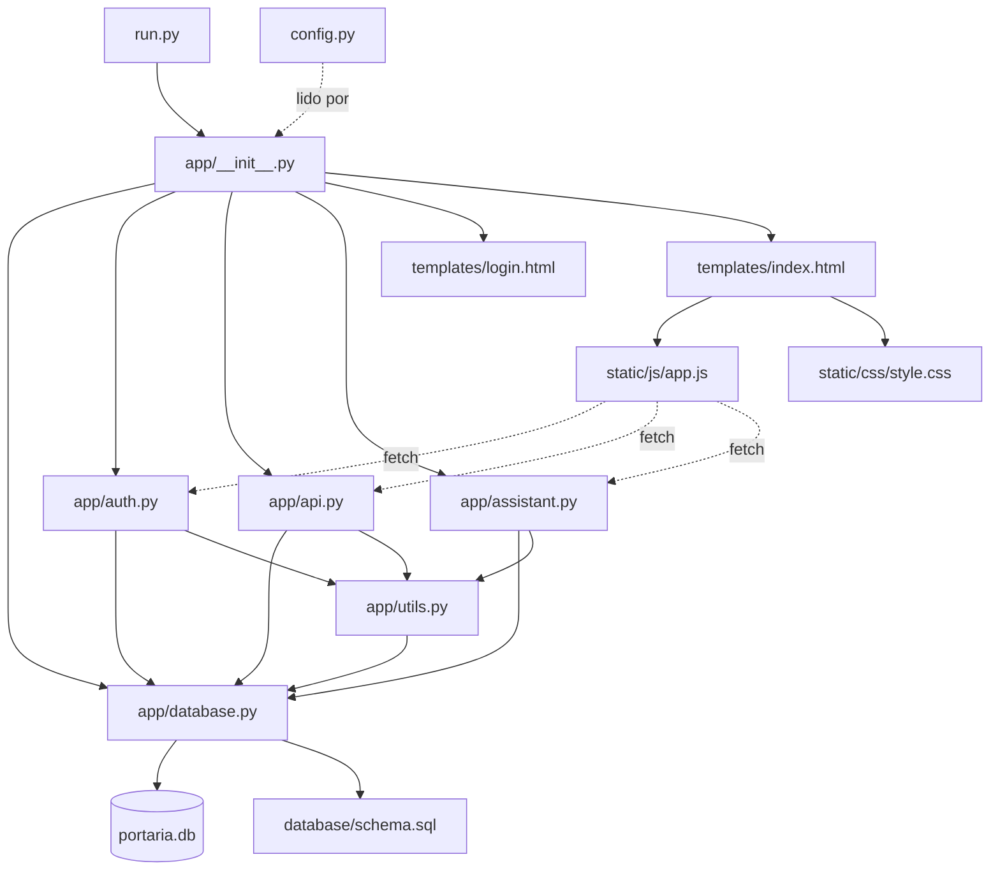

# 🎬 O Filme do Sistema — Linha por Linha, Chamada por Chamada

> Vou contar a história do sistema como se os arquivos fossem **funcionários de um prédio** conversando entre si. Cada um tem uma função; um chama o outro; a informação viaja; uma resposta volta.
>
> Vou seguir **exatamente a ordem cronológica** que o Python executa. Não vou pular nenhum passo.

---

## 📌 ANTES DE COMEÇAR — o elenco dos arquivos

| Arquivo | "Personagem" | Função |
|---|---|---|
| `run.py` | **Gerente geral** | Dispara tudo. Chama a fábrica. Sobe o servidor. |
| `config.py` | **Manual de configurações** | Onde ficam as "regras da casa" (caminhos, chave secreta). |
| `app/__init__.py` | **Fábrica** | Monta o servidor, registra blueprints, cria o banco. |
| `app/database.py` | **Bibliotecário** | Abre/fecha o arquivo do banco. |
| `app/utils.py` | **Segurança da porta** | Verifica se está logado e se tem permissão. |
| `app/auth.py` | **Recepcionista** | Faz login, logout, gerencia sessão. |
| `app/api.py` | **Atendente universal** | CRUD genérico de todas as entidades. |
| `app/assistant.py` | **Concierge** | Responde perguntas em linguagem natural. |
| `database/schema.sql` | **Planta do prédio** | Desenho das tabelas. |
| `templates/login.html` | **Cartaz do login** | HTML da tela de entrada. |
| `templates/index.html` | **Cartaz do sistema** | HTML da SPA (casca). |
| `static/js/app.js` | **Cérebro do navegador** | Toda a lógica do cliente. |
| `static/css/style.css` | **Decoração** | Aparência. |

---

# 🎬 PARTE 1 — O GERENTE GRITA: `python run.py`

Você digita no terminal:

```bash
python run.py
```

O Python **encontra o arquivo** `run.py` e começa a executá-lo **de cima para baixo**, linha por linha.

---

## 🎯 Linha 1 de `run.py` — `from app import create_app`

```python
from app import create_app
```

### O que o Python faz aqui (passo a passo **interno**)

**Passo 1** — o Python olha a palavra `app` e pensa: *"Isso é um módulo. Onde está?"*

**Passo 2** — procura uma pasta chamada `app/` no diretório de `run.py`. Encontra.

**Passo 3** — como `app/` tem `__init__.py`, é um **pacote Python**. O Python então **executa `app/__init__.py` inteiro** antes de importar qualquer coisa.

> 🧠 **Analogia**: o gerente (`run.py`) diz "vou chamar a fábrica". A fábrica (`__init__.py`) **abre as portas, lê todos os manuais internos, contrata os funcionários** e só então está pronta para atender.

### A execução de `app/__init__.py` começa

**`app/__init__.py` — linha 1:**

```python
import os
```

📞 **Conversa**: o arquivo `__init__.py` pede ao Python: *"me dá o módulo `os`"*. O Python carrega o módulo nativo que lida com caminhos e variáveis de ambiente. **Nenhum outro arquivo do projeto é chamado aqui.**

**`app/__init__.py` — linha 2:**

```python
from flask import Flask, render_template, session, redirect, url_for
```

📞 **Conversa**: `__init__.py` pede ao Flask **5 ferramentas**:
- `Flask` → a classe que cria a instância do servidor.
- `render_template` → renderiza HTML.
- `session` → lê/grava cookie de sessão.
- `redirect` → redireciona.
- `url_for` → gera URL a partir do nome do endpoint.

O Python carrega o pacote `flask` (instalado via pip). **Ainda não toca em `app/api.py` nem nada do projeto.**

**`app/__init__.py` — linha 3:**

```python
from werkzeug.security import generate_password_hash
```

📞 `__init__.py` pede ao Werkzeug a função que gera hash de senha. **Só essa função**, nada mais.

**`app/__init__.py` — linha 4:**

```python
from .database import init_db, get_db
```

### 🔥 PRIMEIRA CONVERSA REAL ENTRE ARQUIVOS DO PROJETO 🔥

O `.` significa *"do mesmo pacote"*. O Python:

1. Abre `app/database.py`
2. **Executa `app/database.py` inteiro**

**`app/database.py` — linha 1:**

```python
import sqlite3
```
→ Carrega o driver SQLite nativo do Python.

**`app/database.py` — linha 2:**

```python
from flask import g, current_app
```
→ Carrega 2 ferramentas do Flask:
- `g` → "espaço temporário" por requisição (usaremos para guardar a conexão).
- `current_app` → referência ao app Flask atual.

**`app/database.py` — linhas 5–22:** define 3 funções (`get_db`, `close_db`, `init_db`). **Elas só são definidas, não executadas ainda.** O Python pula para o final do arquivo.

3. Devolve ao `__init__.py`: `init_db` e `get_db` (as duas funções).

**`app/__init__.py` — linha 5:**

```python
from .auth import auth_bp
```

### Outra conversa em cadeia

1. Abre `app/auth.py`
2. **Executa `app/auth.py` inteiro**

**`app/auth.py` — linha 1:**

```python
from flask import Blueprint, request, jsonify, session, render_template, redirect, url_for
```
→ 7 ferramentas do Flask. `Blueprint` é **novo** aqui — é a ferramenta que cria "sub-apps" (grupos de rotas).

**`app/auth.py` — linha 2:**

```python
from werkzeug.security import check_password_hash, generate_password_hash
```
→ Agora `check_password_hash` (para comparar senha) além do `generate_...`.

**`app/auth.py` — linha 3:**

```python
from .database import get_db
```
→ Reaproveita o `get_db`. **O Python já carregou `database.py` na linha anterior**, então só pega a referência que está em cache. Não recarrega.

**`app/auth.py` — linha 4:**

```python
from .utils import login_required, admin_required, log_audit
```

### 🔥 SEGUNDA CONVERSA ENTRE ARQUIVOS DO PROJETO 🔥

1. Abre `app/utils.py`
2. **Executa `app/utils.py` inteiro**

**`app/utils.py` — linha 1:**

```python
from functools import wraps
```
→ Ferramenta nativa que preserva nome/docstring em decorators.

**`app/utils.py` — linha 2:**

```python
from flask import session, jsonify
```
→ `session` para checar login, `jsonify` para responder JSON.

**`app/utils.py` — linha 3:**

```python
from datetime import datetime
```
→ Para timestamps de auditoria.

**`app/utils.py` — linha 4:**

```python
from .database import get_db
```
→ Reaproveita `get_db` (já estava em cache).

**`app/utils.py` — linhas 8–40:** define **5 funções** (`login_required`, `admin_required`, `log_audit`, `allowed_file`, `pode`). Só define, não executa.

3. Devolve a `auth.py`: as 3 funções pedidas.

**`app/auth.py` — linha 6:**

```python
auth_bp = Blueprint("auth", __name__)
```

🎬 **EXECUÇÃO REAL!** Aqui **não é só definição** — é a criação de um **objeto em memória**.

📞 `auth.py` diz ao Flask: *"crie para mim um 'sub-app' chamado `auth`"*. O Flask devolve um objeto `Blueprint` que `auth.py` guarda na variável `auth_bp`.

**Por que `"auth"`?** É o **prefixo dos nomes de endpoint**. Quando `app/__init__.py` faz `url_for("auth.login_page")`, o Flask procura a função `login_page` **dentro** do blueprint chamado `auth`. Sem o prefixo, dois blueprints não poderiam ter funções com o mesmo nome.

**`app/auth.py` — linhas 9–15:** define `login_page()` (rota `GET /login`). Só define.

**`app/auth.py` — linhas 18–38:** define `api_login()` (rota `POST /api/login`). Só define.

**`app/auth.py` — linhas 41–47:** `api_logout()` (rota `POST /api/logout`). Só define.

**`app/auth.py` — linhas 50–85:** `api_me()` (rota `GET /api/me`). Só define.

**`app/auth.py` — linhas 88–140:** `api_usuarios()`, `api_usuario()` (CRUD de usuários). Só define.

**`app/auth.py` — linhas 143–190:** `api_permissoes_list()`, `api_permissoes_update()`. Só define.

Fim de `auth.py`. Volta ao `__init__.py` entregando `auth_bp`.

**`app/__init__.py` — linha 6:**

```python
from .api import api_bp, ENTITIES
```

### 🔥 TERCEIRA CONVERSA — a maior 🔥

1. Abre `app/api.py`
2. **Executa `app/api.py` inteiro**

**`app/api.py` — linha 1:**

```python
import os
```
→ `os.path.join` para salvar uploads.

**`app/api.py` — linha 2:**

```python
import uuid
```
→ Gerar nomes únicos para uploads.

**`app/api.py` — linha 3:**

```python
from flask import Blueprint, request, jsonify, session, current_app
```
→ 5 ferramentas. `current_app` serve para ler `UPLOAD_FOLDER` do config.

**`app/api.py` — linha 4:**

```python
from .database import get_db
```
→ Já estava em cache.

**`app/api.py` — linha 5:**

```python
from .utils import login_required, log_audit, allowed_file, pode
```
→ Já estava em cache.

**`app/api.py` — linhas 10–35: `ENTITIES = {...}`**

🎬 **EXECUÇÃO REAL!** Um **grande dicionário** é construído em memória, com **24 entidades**. Cada chave (ex.: `"visitantes"`) aponta para um dict `{"table": ..., "fields": [...], "search": [...], "order": ...}`.

📞 `api.py` diz ao Python: *"guarde esse dicionário na memória; todo mundo que importar `ENTITIES` vai ver o mesmo objeto"*. **Isso é essencial**: `__init__.py` vai usar para criar permissões, `auth.py` para listar entidades, `assistant.py` para saber o que existe.

**`app/api.py` — linha 42:**

```python
api_bp = Blueprint("api", __name__, url_prefix="/api")
```
🎬 **EXECUÇÃO REAL!** Cria o blueprint `api` **com prefixo `/api`**. Isso significa que **toda rota** registrada nele ganha `/api/...` automaticamente. `@api_bp.route("/<entity>")` vira `/api/<entity>`.

**`app/api.py` — linhas 47–91:** define `crud_collection()` (GET/POST genérico). Só define.

**`app/api.py` — linhas 94–131:** `crud_item()` (GET/PUT/DELETE por id). Só define.

**`app/api.py` — linhas 134–148:** `api_upload()`. Só define.

**`app/api.py` — linhas 151–173:** `dashboard_stats()`. Só define.

**`app/api.py` — linhas 176–200:** `registrar_saida()`, `retirar_encomenda()`, `resolver_ocorrencia()`. Só define.

**`app/api.py` — linhas 203–220:** `listar_unidades()`, `auditoria_list()`. Só define.

Fim de `api.py`. Volta ao `__init__.py` entregando `api_bp` **e** `ENTITIES`.

**`app/__init__.py` — linha 7:**

```python
from .assistant import assistant_bp
```

### 🔥 ÚLTIMA CONVERSA DE IMPORTS 🔥

1. Abre `app/assistant.py`
2. **Executa `app/assistant.py` inteiro**

**`app/assistant.py` — linha 1:** `import re` → regex.
**`app/assistant.py` — linha 2:** `from datetime import date, datetime` → data/hora.
**`app/assistant.py` — linha 3:** `from flask import Blueprint, request, jsonify` → 3 ferramentas.
**`app/assistant.py` — linha 4:** `from .database import get_db` → já em cache.
**`app/assistant.py` — linha 5:** `from .utils import login_required, pode` → já em cache.

**`app/assistant.py` — linha 7:**

```python
assistant_bp = Blueprint("assistant", __name__, url_prefix="/api/assistant")
```
🎬 **EXECUÇÃO REAL!** Cria o blueprint com prefixo `/api/assistant`.

**`app/assistant.py` — linhas 10–28:** define `norm()` e `_achar_unidade()`. Só define.

**`app/assistant.py` — linha 31:** `@assistant_bp.route("/chat", methods=["POST"])` — **registra a rota**. Quando o app for montado, `POST /api/assistant/chat` chamará `chat()`.

**`app/assistant.py` — linhas 32–240:** define `chat()`. **Só define.**

Fim de `assistant.py`. Volta ao `__init__.py` entregando `assistant_bp`.

### 🎯 Fim dos imports. Estado atual da memória

Depois de tanta conversa, o Python tem em memória:

| Objeto | Quem criou | Conteúdo |
|---|---|---|
| `os`, `flask`, `sqlite3` etc. | stdlib / pip | Módulos de terceiros |
| `init_db`, `get_db`, `close_db` | `database.py` | Funções prontas |
| `login_required`, `pode`, etc. | `utils.py` | Funções prontas |
| `auth_bp` | `auth.py` | Blueprint com 8 rotas registradas |
| `api_bp` | `api.py` | Blueprint com ~7 rotas |
| `ENTITIES` | `api.py` | Dicionário com 24 entidades |
| `assistant_bp` | `assistant.py` | Blueprint com 1 rota |
| `create_app`, `_auto_seed`, `_auto_permissoes` | `__init__.py` | Funções prontas |

**Nenhuma requisição foi processada ainda.** Só as "fundações" foram levantadas.

---

## 🎯 Linha 2 de `run.py` — `app = create_app()`

```python
app = create_app()
```

🎬 **Agora o gerente (`run.py`) chama a fábrica.** Isso **executa** a função `create_app()`.

### Dentro de `create_app()` — `app/__init__.py` linhas 56–84

**Linha 57:**

```python
app = Flask(__name__, template_folder="../templates", static_folder="../static")
```

📞 `create_app()` diz ao Flask: *"fabrique um servidor"*.
- `__name__` = `"app"` → nome do pacote.
- `template_folder="../templates"` → **um nível acima** de `app/`, na raiz do projeto. Sem isso, o Flask procuraria `app/templates/` (não existe).
- `static_folder="../static"` → mesma ideia para CSS/JS.

O Flask devolve um objeto `Flask` — **o servidor em si**.

**Linha 58:**

```python
from config import Config
```

📞 Dentro da função, o Python abre `config.py` e executa.
- `config.py` linha 1: `import os` → já carregado.
- `config.py` linha 3: `BASE_DIR = os.path.abspath(os.path.dirname(__file__))` → **executa**: descobre a pasta do `config.py`. Resultado: `"D:\Projetos\python\sistema de portaria"`.
- `config.py` linhas 5–13: define `class Config:` com atributos. **A classe é criada**, valores calculados (`DATABASE`, `SCHEMA`, `UPLOAD_FOLDER`).
- Devolve `Config` ao `create_app()`.

**Por que importar aqui dentro?** Se fosse no topo de `__init__.py`, poderia gerar **import circular** (config não importa nada de `app`, mas em projetos maiores isso ocorre). Colocar dentro da função é padrão defensivo.

**Linha 59:**

```python
app.config.from_object(Config)
```

📞 `create_app()` diz ao Flask: *"copie tudo de `Config` para seu dicionário de config"*. Agora `app.config["SECRET_KEY"]`, `app.config["DATABASE"]`, etc. existem.

**Linha 61:**

```python
os.makedirs(app.config["UPLOAD_FOLDER"], exist_ok=True)
```

📞 Lê `UPLOAD_FOLDER` da config → cria a pasta `static/uploads/`. `exist_ok=True` evita erro se já existir.

**Linha 63:**

```python
init_db(app)
```

### 📞 `create_app()` chama `init_db()` de `database.py`

**`database.py` linha 21 — `def init_db(app):`**

**Linha 22:** `with app.app_context():` — entra no contexto do Flask. **Por que?** Porque `get_db()` usa `current_app` e `g`, que só existem dentro de uma requisição **ou** de um `app_context()`.

**Linha 23:** `db = get_db()` → **chama `get_db()` de `database.py` mesmo**.

### 📞 `init_db` chama `get_db()`

**`get_db()` linha 6:** `if "db" not in g:` — `g` está **vazio** (primeira vez). Entra no if.

**Linha 7:** `g.db = sqlite3.connect(current_app.config["DATABASE"])` — **abre o arquivo `portaria.db`**. Se não existir, SQLite **cria automaticamente** um arquivo vazio.

**Linha 8:** `g.db.row_factory = sqlite3.Row` — configura o driver para que cada linha retorne como objeto tipo dicionário (`row["nome"]`).

**Linha 9:** `g.db.execute("PRAGMA foreign_keys = ON")` — liga chaves estrangeiras (desligadas por padrão no SQLite).

**Linha 10:** `return g.db` — devolve a conexão.

De volta a `init_db`:

**Linha 24:** `with open(app.config["SCHEMA"], encoding="utf-8") as f:` → abre `database/schema.sql`.

**Linha 25:** `db.executescript(f.read())` → **executa todas as 24 `CREATE TABLE IF NOT EXISTS` de uma vez**. Se as tabelas já existirem, não faz nada.

**Linha 26:** `db.commit()` → salva.

**Linha 27:** `app.teardown_appcontext(close_db)` → **registra** que, ao final de cada requisição (ou do bloco `with`), `close_db()` deve rodar. Ainda **não executa** agora.

Volta a `create_app()`.

**Linha 64:**

```python
_auto_seed(app)
```

### 📞 `create_app()` chama `_auto_seed()` de `__init__.py`

**`_auto_seed` linha 11:** `with app.app_context():` — novo contexto.

**Linha 12:** `db = get_db()` → como ainda estamos **no mesmo contexto do `init_db`** (não saiu do `with`), `g` ainda tem a conexão. Reaproveita.

**Linha 13:** `total = db.execute("SELECT COUNT(*) FROM usuarios").fetchone()[0]` → conta usuários. Como o banco acabou de ser criado, retorna `0`.

**Linha 14:** `if total == 0:` → **verdadeiro na primeira execução**.

**Linha 15–18:** `db.execute("INSERT INTO usuarios ...")` → insere **admin**. `generate_password_hash("admin123")` é **executado aqui**: gera hash PBKDF2-SHA256 com salt aleatório. **A senha original nunca é salva em lugar nenhum**.

**Linha 19–22:** insere **Carlos Porteiro**.

**Linha 23:** `db.commit()` → salva no arquivo `.db`.

**Linha 24:** `print("✅ Usuários padrão criados: ...")` → **aparece no seu terminal**.

Volta a `create_app()`.

**Linha 65:**

```python
_auto_permissoes(app)
```

### 📞 `create_app()` chama `_auto_permissoes()` de `__init__.py`

**Linha 27:** `with app.app_context():` — novo contexto.

**Linha 28:** `db = get_db()` → reaproveita a conexão.

**Linha 29:** `entidades = list(ENTITIES.keys()) + ESPECIAIS`
- `ENTITIES.keys()` → 24 entidades do `api.py`.
- `ESPECIAIS` → `["dashboard", "assistente", "auditoria"]`.
- `+` → concatena. Resultado: **27 nomes**.

**Linha 30:** `criados = 0` — contador.

**Linha 31:** `for ent in entidades:` — **loop de 27 iterações**.

**Dentro do loop — linha 32:**

```python
cur = db.execute("INSERT OR IGNORE INTO permissoes (perfil, entidade, ...) VALUES ('porteiro', ?, 1, 1, 1, 0)", (ent,))
```

📞 Para **cada** entidade, insere uma linha com:
- `perfil = 'porteiro'`
- `entidade = ent`
- `pode_ver = 1`, `pode_criar = 1`, `pode_editar = 1`, `pode_excluir = 0`

`INSERT OR IGNORE` respeita o `UNIQUE(perfil, entidade)` — se já existir, **pula sem erro**.

**Linha 33:** `criados += cur.rowcount` — soma quantas inseriu.

**Linha 34:** `db.commit()`.

**Linha 35–36:** imprime `✅ 27 permissões padrão criadas.`

Volta a `create_app()`.

**Linha 67–69:**

```python
app.register_blueprint(auth_bp)
app.register_blueprint(api_bp)
app.register_blueprint(assistant_bp)
```

📞 **Momentos importantes**: o Flask **anexa** os blueprints ao servidor principal.

Ao registrar `auth_bp` (sem prefixo), as rotas ficam:
- `GET /login` → `auth.login_page`
- `POST /api/login` → `auth.api_login`
- `POST /api/logout` → `auth.api_logout`
- `GET /api/me` → `auth.api_me`
- `GET /api/usuarios` / `POST` → `auth.api_usuarios`
- `PUT/DELETE /api/usuarios/<int>` → `auth.api_usuario`
- `GET /api/permissoes` → `auth.api_permissoes_list`
- `PUT /api/permissoes/<ent>` → `auth.api_permissoes_update`

Ao registrar `api_bp` (prefixo `/api`), as rotas ficam:
- `GET/POST /api/<entity>` → `api.crud_collection`
- `GET/PUT/DELETE /api/<entity>/<int>` → `api.crud_item`
- `POST /api/upload` → `api.api_upload`
- `GET /api/dashboard/stats` → `api.dashboard_stats`
- `POST /api/visitantes/<int>/saida` → `api.registrar_saida`
- `POST /api/encomendas/<int>/retirar` → `api.retirar_encomenda`
- `POST /api/ocorrencias/<int>/resolver` → `api.resolver_ocorrencia`
- `GET /api/unidades` → `api.listar_unidades`
- `GET /api/auditoria` → `api.auditoria_list`

Ao registrar `assistant_bp` (prefixo `/api/assistant`):
- `POST /api/assistant/chat` → `assistant.chat`

**O Flask agora tem a "tabela de rotas" cheia.** Sabe que quando chegar `GET /api/visitantes`, deve chamar `api.crud_collection("visitantes")`.

**Linha 71–78:** define a rota `/` (index):

```python
@app.route("/")
def index():
    if "user_id" not in session:
        return redirect(url_for("auth.login_page"))
    return render_template("index.html")
```

📞 Registra uma **9ª rota**: `GET /` → `index()`.

**Linha 80:** `return app` — **devolve o servidor montado e configurado** ao `run.py`.

---

## 🎯 Linha 3 de `run.py` — `if __name__ == "__main__":`

```python
if __name__ == "__main__":
```

`__name__` é `"__main__"` **porque o arquivo foi executado diretamente** (`python run.py`). Se fosse importado por outro módulo, seria `"run"` (o nome do módulo) e o bloco abaixo **não** executaria. **Padrão de ouro do Python** para separar "rodar como script" de "importar como biblioteca".

**Linha 4:**

```python
app.run(host="0.0.0.0", port=5000, debug=True)
```

📞 O gerente diz ao Flask: *"suba o servidor de desenvolvimento na porta 5000, aceitando qualquer IP da rede, com auto-reload"*.

O Flask entra num **loop infinito** esperando requisições HTTP. A partir daqui:

```
 * Running on http://0.0.0.0:5000
 * Debug mode: on
```

**O terminal fica "travado" nesse loop.** Ou seja, o `python run.py` **nunca termina sozinho**. Fica esperando a porta 5000 ser batida.

---

# 🎬 PARTE 2 — O SERVIDOR DORME, ESPERANDO ALGUÉM BATER NA PORTA

A partir de agora **nada mais do código roda** até chegar uma requisição HTTP. O Flask fica num loop de baixo nível:

```
while True:
    request = socket.accept()       # espera conexão
    parse_http(request)              # interpreta método, path, headers, body
    route = match_route(path)        # encontra a função registrada
    call_function(route)             # executa a função
    send_response()                  # devolve resposta HTTP
```

**O Python só "acorda" quando alguém abre o navegador.**

---

# 🎬 PARTE 3 — USUÁRIO ABRE O NAVEGADOR: `http://192.168.1.10:5000`

## CENA 3.1 — Primeira requisição: `GET /`

Navegador manda:

```http
GET / HTTP/1.1
Host: 192.168.1.10:5000
Cookie: (nenhum)
```

### 📞 Flask recebe, procura na tabela de rotas

Encontra `GET /` → **chama `index()`** de `app/__init__.py`.

### Dentro de `index()`

**Linha 73:**

```python
if "user_id" not in session:
```

📞 `index()` pergunta ao Flask: *"o cookie de sessão tem `user_id`?"*. Como é a **primeira vez** (nenhum cookie), `session` é um dicionário **vazio**.

**Linha 74:**

```python
return redirect(url_for("auth.login_page"))
```

📞 `url_for("auth.login_page")` procura na tabela de rotas um endpoint chamado `login_page` **dentro do blueprint `auth`**. Encontra: `GET /login`.

Resultado: `/login`.

📞 `redirect("/login")` devolve:

```http
HTTP/1.1 302 Found
Location: /login
```

### 📞 Navegador obedece o 302 e pede `GET /login`

## CENA 3.2 — Segunda requisição: `GET /login`

### 📞 Flask procura na tabela: `GET /login` → **chama `login_page()`** de `auth.py`

**`auth.py` linha 10:**

```python
return render_template("login.html")
```

📞 `render_template` diz ao Flask: *"procure `login.html` na pasta `templates/` e me devolva o HTML"*. O Flask já sabe que `template_folder="../templates"` (definido em `create_app`).

O Flask lê `templates/login.html` do disco, **não executa Jinja2 especial** (o arquivo não tem `{{ }}`), e devolve o HTML **inteiro**.

### 📞 Navegador recebe o HTML

```http
HTTP/1.1 200 OK
Content-Type: text/html
...
```

Renderiza a tela de login. O usuário vê o **card** com campos Usuário e Senha.

**O JS embutido no `login.html` já foi carregado** — a função `onsubmit` está registrada, esperando o usuário clicar em "Entrar".

---

# 🎬 PARTE 4 — USUÁRIO DIGITA E CLICA "ENTRAR"

## CENA 4.1 — O JavaScript intercepta o submit

Dentro do `templates/login.html`, o script já registrado:

```javascript
document.getElementById('login-form').onsubmit = async (e) => {
```

Quando o usuário clica em "Entrar":

**Linha 1 do handler:** `e.preventDefault()` → **impede** que o navegador faça o `POST` nativo (que recarregaria a página). Nós controlamos o envio.

**Linha 2:** `const fd = new FormData(e.target)` → lê os campos `usuario` e `senha` do form.

**Linha 3:** `const msg = document.getElementById('login-msg')` → pega o `<p>` de mensagens.

**Linha 4:** `msg.textContent = 'Verificando...'` → feedback visual.

**Linha 5–9:**

```javascript
const r = await fetch('/api/login', {
  method: 'POST',
  headers: { 'Content-Type': 'application/json' },
  body: JSON.stringify({ usuario: fd.get('usuario'), senha: fd.get('senha') })
});
```

📞 **Navegador envia requisição HTTP ao servidor Flask:**

```http
POST /api/login HTTP/1.1
Content-Type: application/json

{"usuario":"admin","senha":"admin123"}
```

## CENA 4.2 — O servidor Flask acorda

### 📞 Flask procura na tabela: `POST /api/login` → **chama `api_login()`** de `auth.py`

**`auth.py` linha 19:**

```python
data = request.get_json() or request.form
```

📞 `api_login()` pergunta ao Flask: *"o corpo é JSON?"*. Sim → `request.get_json()` devolve `{"usuario": "admin", "senha": "admin123"}`.

**Linha 20:**

```python
usuario = (data.get("usuario") or "").strip().lower()
```

- Pega `"admin"`.
- `.strip()` → remove espaços.
- `.lower()` → **"admin"** (já é minúsculo).

**Linha 21:**

```python
senha = data.get("senha") or ""
```
→ `"admin123"`.

**Linha 22:**

```python
db = get_db()
```

### 📞 `api_login()` chama `get_db()` de `database.py`

**`get_db()` linha 6:** `if "db" not in g:` — **`g` está vazio** (nova requisição, o `g` de antes foi destruído no teardown). Entra no if.

**Linha 7:** abre `portaria.db` de novo (rápido).

**Linha 8–10:** configura `row_factory`, liga `PRAGMA`, **retorna `g.db`**.

De volta a `api_login()`:

**Linha 23–25:**

```python
row = db.execute(
    "SELECT * FROM usuarios WHERE lower(usuario)=? AND ativo=1", (usuario,)
).fetchone()
```

📞 **SQL executado no SQLite**. O `?` é substituído por `"admin"` **no driver**, **não por concatenação**. Isso previne SQL injection.

SQLite usa o índice da coluna `usuario UNIQUE` → retorna rápido:

```
id=1, nome="Administrador", usuario="admin",
senha_hash="pbkdf2:sha256:...", perfil="admin", ativo=1
```

**Linha 26:**

```python
if not row or not check_password_hash(row["senha_hash"], senha):
```

📞 Chama `check_password_hash` do Werkzeug:
- Pega o hash salvo (`pbkdf2:sha256:...`) — que contém **o salt embutido**.
- Aplica PBKDF2-SHA256 em `"admin123"` com esse salt.
- Compara com o hash salvo.

Se bater → `False` (não entra no if). Se falhar → devolve `{"error": "..."}, 401`. **Como admin123 está certo**, segue.

**Linha 28–31:**

```python
session["user_id"] = row["id"]
session["usuario"] = row["usuario"]
session["nome"] = row["nome"]
session["perfil"] = row["perfil"]
```

🎬 **EXECUÇÃO CRÍTICA!** 📞 `api_login()` diz ao Flask: *"guarde esses 4 valores na sessão"*.

O Flask faz **duas coisas**:
1. Serializa o `session` em JSON.
2. **Assina** com `SECRET_KEY` (HMAC-SHA1). Se alguém editar o cookie, a assinatura **não bate** → Flask rejeita.
3. Codifica em base64 → coloca no header `Set-Cookie: session=...`.

**Linha 32:**

```python
log_audit("Login", row["usuario"])
```

### 📞 `api_login()` chama `log_audit()` de `utils.py`

**`utils.py` linha 20–26:**

**Linha 21:** `db = get_db()` → reaproveita a conexão.

**Linha 22–25:**

```python
db.execute(
    "INSERT INTO auditoria (ts, usuario, acao, detalhe) VALUES (?,?,?,?)",
    (datetime.utcnow().isoformat(), session.get("usuario", "sistema"), acao, detalhe),
)
```

📞 Executa INSERT em `auditoria`:
- `ts` = agora em UTC ISO.
- `usuario` = `"admin"` (da sessão).
- `acao` = `"Login"`.
- `detalhe` = `"admin"`.

**Linha 26:** `db.commit()` → salva.

De volta a `api_login()`:

**Linha 33:**

```python
return jsonify({"ok": True})
```

📞 Flask serializa `{"ok": true}` para JSON, devolve:

```http
HTTP/1.1 200 OK
Content-Type: application/json
Set-Cookie: session=eyJ1c2VyX2lkIjoxLC...; HttpOnly; Path=/

{"ok": true}
```

## CENA 4.3 — O JavaScript recebe a resposta

```javascript
const j = await r.json();          // {ok: true}
if (!r.ok) { ...; return; }        // r.ok é true → não entra
location.href = '/';               // redireciona
```

📞 Navegador faz **nova requisição** `GET /` **agora com o cookie** `session=...` no header.

---

# 🎬 PARTE 5 — CARREGAMENTO DA SPA (primeira vez autenticado)

## CENA 5.1 — `GET /` de novo, agora com cookie

### 📞 Flask procura: `GET /` → **chama `index()`** de `__init__.py`

**Linha 73:** `if "user_id" not in session:`

📞 O Flask **desassina** o cookie com `SECRET_KEY`. Verifica a assinatura. Se válida, decodifica o JSON: `{"user_id": 1, "usuario": "admin", "nome": "Administrador", "perfil": "admin"}`.

`"user_id" in session` → **True**. Pula o if.

**Linha 76:**

```python
return render_template("index.html")
```

📞 Lê `templates/index.html` e devolve.

## CENA 5.2 — Navegador recebe `index.html` e carrega recursos

O HTML tem:

```html
<link rel="stylesheet" href="/static/css/style.css">
<script src="/static/js/app.js"></script>
```

📞 Navegador dispara **duas requisições em paralelo**:

1. `GET /static/css/style.css`
2. `GET /static/js/app.js`

O **Flask serve arquivos estáticos automaticamente** (porque passamos `static_folder` no `Flask(...)`). Não passa por blueprint nenhum. O Flask lê direto do disco e devolve.

## CENA 5.3 — `app.js` começa a rodar

O `app.js` inteiro é executado **de cima para baixo**:

**Linhas 4–7 — helpers** — só definem funções.

**Linhas 15–21 — `api()`** — define.

**Linhas 27–32 — `toast()`** — define.

**Linhas 37–400 — `ENTITIES = {...}`** — cria o grande dicionário em memória. **24 entidades** com `fields`, `cols`, `rowActions`, etc.

**Linhas 403–450 — `MENU = [...]`** — cria o array de itens do menu.

**Linhas 452–454 — variáveis globais**: `session = null`, `currentView = 'dashboard'`, `unidadesCache = []`.

**Linhas 460–486 — `boot()`** — define.

**Linhas 488–508 — `montarNav()`** — define.

**Linhas 510–538 — `navigate()`** — define.

**... e assim por diante até o último `boot()` da linha ~1120.**

**Última linha do arquivo: `boot();`**

🎬 **AQUI O JAVASCRIPT "ACORDA".**

## CENA 5.4 — Dentro de `boot()`

**Linha 461:**

```javascript
session = await api('/api/me');
```

### 📞 `boot()` chama `api('/api/me')`

**`api()` linha 16–21:**

**Linha 17:** `const r = await fetch('/api/me', {headers:{'Content-Type':'application/json'}, ...opts});`

📞 **Navegador envia** `GET /api/me` (com o cookie).

### 📞 Flask acorda: `GET /api/me` → **chama `api_me()`** de `auth.py`

**Linha 51:** `from .api import ENTITIES` — import **dentro da função** (evita ciclo). Como `api.py` já foi carregado no boot, é só lookup em cache. Rápido.

**Linha 52:** `ESPECIAIS = [...]` — lista local.

**Linha 53:** `db = get_db()` → conexão nova para esta requisição.

**Linha 54:** `perfil = session.get("perfil")` → `"admin"`.

**Linha 55:** `todas = list(ENTITIES.keys()) + ESPECIAIS` → 27 nomes.

**Linha 57:**

```python
if perfil == "admin":
```

**Linha 58–59:**

```python
perms = {ent: {"ver": True, "criar": True, "editar": True, "excluir": True}
         for ent in todas}
```

📞 Como é admin, monta dict **com tudo True**. **Não consulta o banco** — admin é soberano.

**Linha 78–83:**

```python
return jsonify({
    "usuario": session.get("usuario"),
    "nome": session.get("nome"),
    "perfil": perfil,
    "permissoes": perms,
})
```

📞 Devolve JSON com 27 entradas. Cada uma `{ver:true, criar:true, editar:true, excluir:true}`.

### 📞 `api()` recebe a resposta

**Linha 18:** `if (r.status === 401)` — não. Segue.

**Linha 19:** `const j = await r.json()` → `{usuario:"admin", nome:"Administrador", perfil:"admin", permissoes:{...}}`.

**Linha 20:** `if (!r.ok)` — não.

**Linha 21:** `return j`.

De volta a `boot()`:

**Linha 462:** `window.PERMS = session.permissoes || {};`

🎬 **`window.PERMS` agora está preenchido**. **Todo** o resto do frontend consulta isso.

**Linha 464–466:** preenche `#user-name`, `#user-role`, `#user-avatar` no HTML.

**Linha 468:**

```javascript
unidadesCache = await api('/api/unidades').catch(()=>[]);
```

### 📞 `boot()` chama `api('/api/unidades')`

📞 **Navegador envia** `GET /api/unidades`.

### 📞 Flask: `GET /api/unidades` → **chama `listar_unidades()`** de `api.py`

**`api.py` linha 205:** `db = get_db()`.

**Linha 206–208:**

```python
rows = db.execute(
    "SELECT DISTINCT unidade FROM moradores WHERE unidade IS NOT NULL ORDER BY unidade"
).fetchall()
```

📞 Busca **unidades únicas** dos moradores. **Se não houver moradores cadastrados** (banco virgem), retorna `[]`.

**Linha 209:** `return jsonify([r["unidade"] for r in rows])` → `[]` (lista vazia).

De volta a `boot()`:

**Linha 468:** `unidadesCache = []`.

**Linha 470:** `montarNav();`

### 📞 `montarNav()` percorre o `MENU`

**`montarNav()` linha 489:** `const isAdmin = session.perfil === 'admin'` → `true`.

**Linha 490:** `const perms = window.PERMS || {}` → o objeto do `/api/me`.

**Linha 492:** `$('#nav').innerHTML = MENU.map(m => {...}).join('')`

📞 Para cada item do `MENU`:

- Se tem `m.group` → gera `<div class="group">` (título de seção).
- Se `m.admin && !isAdmin` → pula (mas admin é true, então **mostra tudo**, incluindo Permissões e Usuários).
- Se `m.ent` → verifica `perms[m.ent].ver`. Como admin tem tudo True, mostra.
- Senão → mostra normal.

**Resultado no `#nav`**: ~28 botões de menu.

**Linha 505:** `$$('#nav button').forEach(b => b.onclick = ()=>navigate(b.dataset.nav))`

📞 **Anexa o clique a cada botão**: quando o usuário clicar em "Visitantes", chamará `navigate('visitantes')`.

De volta a `boot()`:

**Linha 471:** `navigate('dashboard');`

### 📞 `navigate('dashboard')`

**`navigate()` linha 511:** acha item no MENU → `{view:'dashboard', ico:'📊', lbl:'Painel'}`.

**Linha 514–518:** verificações de permissão — admin passa.

**Linha 520:** `currentView = 'dashboard'`.

**Linha 521:** marca botão como `active` no menu.

**Linha 522:** `$('#view-title').textContent = 'Painel'`.

**Linha 524:** `$('#topbar-right').innerHTML = "segunda-feira, 02 de novembro"`.

**Linha 526:** `if (view === 'dashboard') return renderDashboard();`

### 📞 `renderDashboard()`

**Linha 546:** `const s = await api('/api/dashboard/stats');`

### 📞 Flask: `GET /api/dashboard/stats` → **chama `dashboard_stats()`** de `api.py`

**`api.py` linha 154:** `if not pode("dashboard", "ver"):`

### 📞 `dashboard_stats` chama `pode()` de `utils.py`

**`utils.py` linha 85:** `if session.get("perfil") == "admin": return True`

📞 Admin **sempre passa**. `pode()` retorna `True`.

De volta a `dashboard_stats()`:

**Linha 156:** `db = get_db()`.

**Linha 158–159:**

```python
def s(sql):
    return db.execute(sql).fetchone()[0]
```

📞 Define um mini-helper **local** (só dentro desta função).

**Linha 161–171:**

```python
return jsonify({
    "dentro":              s("SELECT COUNT(*) FROM visitantes WHERE status='dentro'"),
    "entradas_hoje":       s("SELECT COUNT(*) FROM visitantes WHERE date(entrada)=date('now')"),
    "encomendas_pend":     s("SELECT COUNT(*) FROM encomendas WHERE status='pendente'"),
    "ocorrencias_abertas": s("SELECT COUNT(*) FROM ocorrencias WHERE status='aberta'"),
    "manutencoes_pend":    s("SELECT COUNT(*) FROM manutencoes WHERE status='pendente'"),
    "estoque_baixo":       s("SELECT COUNT(*) FROM produtos_estoque WHERE quantidade<=estoque_minimo"),
    "moradores":           s("SELECT COUNT(*) FROM moradores"),
    "caixas_alerta":       s("SELECT COUNT(*) FROM caixas_agua WHERE nivel_atual<capacidade*0.3"),
    "tags_pendentes":      s("SELECT COUNT(*) FROM solicitacoes_tag WHERE status='pendente'"),
})
```

📞 Executa **9 SELECTs COUNT(*)** contra o SQLite. Cada um usa o índice apropriado (`idx_visitantes_status`, `idx_encomendas_status`, etc.). Banco virgem → tudo `0`.

De volta a `renderDashboard()`:

**Linha 547–555:** monta 9 cards com `n: 0`.

**Linha 557:** limpa `#view` e injeta os cards + "ações rápidas".

**Linha 573–578:**

```javascript
$$('[data-quick]').forEach(b => b.onclick = () => {
  navigate(b.dataset.quick);
  setTimeout(()=> $('[data-action="new"]')?.click(), 300);
});
```

📞 Cada botão "Nova entrada"/"Nova encomenda"/etc. está armado: ao clicar, navega para o módulo e **depois de 300ms** clica no botão "➕ Novo" daquele módulo (que abre o modal).

**Fim do `renderDashboard()`.** Fim do `navigate()`. Fim do `boot()`.

**O usuário vê a tela do dashboard com 9 cards zerados e o menu lateral completo.**

---

# 🎬 PARTE 6 — USUÁRIO CLICA EM "VISITANTES"

## CENA 6.1 — O clique dispara `navigate('visitantes')`

**`navigate()` linha 511:** acha item `{view:'visitantes', ent:'visitantes'}`.

**Linha 514:** `item.admin` é `false` → pula.

**Linha 517–520:** `perms['visitantes'].ver` é `true` (admin) → passa.

**Linha 522:** `currentView = 'visitantes'`.

**Linha 523:** botão "Visitantes" ganha `.active`.

**Linha 524:** `$('#view-title').textContent = 'Visitantes'` (vem de `ENTITIES.visitantes.label`).

**Linha 530:** `if (item.ent) return renderEntity(item.ent);`

### 📞 `renderEntity('visitantes')`

**Linha 590:** `const cfg = ENTITIES['visitantes']` → dicionário com fields, cols, rowActions.

**Linha 591:** `const p = window.PERMS['visitantes']` → `{ver:true, criar:true, editar:true, excluir:true}`.

**Linha 593–605:** monta o HTML:
- toolbar com input `#search` + botão "➕ Novo".
- `<table>` vazia com `<thead>` gerado a partir de `cfg.cols`.
- `<tbody>` com placeholder "Carregando...".

**Linha 607:** `const load = async () => {...}` — **define** a função de carregar.

**Linha 633:** `$('#search').oninput = debounce(load, 250)` — toda digitação no campo de busca **agenda** `load()` 250ms depois (debounce evita chamar a API a cada tecla).

**Linha 634–635:** liga o botão "Novo" a `openForm('visitantes')`.

**Linha 636:** `load();` — **executa imediatamente**.

## CENA 6.2 — Dentro de `load()`

**Linha 608:** `const q = $('#search').value.trim()` → `''` (vazio na primeira vez).

**Linha 609:** `const rows = await api('/api/visitantes')` — como `q` está vazio, **não adiciona `?q=...`**.

### 📞 Flask: `GET /api/visitantes` → **chama `crud_collection("visitantes")`** de `api.py`

**`api.py` linha 50:**

```python
if entity not in ENTITIES:
    return jsonify({"error": "entidade desconhecida"}), 404
```

`'visitantes'` está em `ENTITIES` → passa.

**Linha 54:**

```python
acao = "ver" if request.method == "GET" else "criar"
```

`request.method` → `"GET"`. `acao = "ver"`.

**Linha 55:**

```python
if not pode(entity, acao):
    return jsonify({"error": "sem permissão"}), 403
```

### 📞 Chama `pode('visitantes', 'ver')` de `utils.py`

**`utils.py` linha 85:** `if session.get("perfil") == "admin": return True`

📞 `perfil` é `"admin"` → retorna `True` **sem consultar o banco**.

De volta a `crud_collection`:

**Linha 58:** `cfg = ENTITIES['visitantes']` → dicionário da entidade.

**Linha 59:** `db = get_db()` → conexão.

**Linha 61:** `if request.method == "GET":` → **entra**.

**Linha 62:** `q = request.args.get("q", "").strip()` → `""`.

**Linha 63–65:**

```python
filtros = request.args.to_dict()
filtros.pop("q", None)
```

📞 Pega todos os parâmetros da query string. Como não há, fica `{}`.

**Linha 66:** `sql = "SELECT * FROM visitantes"`.

**Linha 67–68:** `wheres, params = [], []`.

**Linha 69:** `if q and cfg.get("search"):` → `q` é `""` → **pula**.

**Linha 73:** `for k, v in filtros.items():` → `{}` → **não itera**.

**Linha 77:** `if wheres:` → `[]` → **pula**.

**Linha 79:** `sql += " ORDER BY entrada DESC"`.

SQL final: `SELECT * FROM visitantes ORDER BY entrada DESC`.

**Linha 80:** `rows = db.execute(sql, params).fetchall()` → SQLite executa. Banco virgem → `[]`.

**Linha 81:** `return jsonify([dict(r) for r in rows])` → `[]`.

### 📞 De volta a `load()`

**Linha 611:** `if (!rows.length)` → `true` → entra.

**Linha 612:** `tbody.innerHTML = '<tr><td colspan="6" class="empty">Nenhum registro.</td></tr>'`

📞 Renderiza "Nenhum registro" na tabela.

## CENA 6.3 — Usuário clica em "➕ Novo"

**Linha 635:** o botão foi armado em `renderEntity` para chamar `openForm('visitantes')`.

### 📞 `openForm('visitantes')`

**Linha 694:** `const cfg = ENTITIES['visitantes']`.

**Linha 695:** `const bodyHTML = cfg.fields.map(f => renderField(f, item?.[f.n])).join('')`

📞 Para cada campo em `cfg.fields`, chama `renderField()`. `item` é `null` (novo), então `item?.[f.n]` = `undefined` → `renderField` usa `f.def` se houver.

**Dentro do `map`, para cada `f`:**

- `renderField({n:'nome', l:'Nome', t:'text', req:true}, undefined)`
  - Linha 728: `const v = value ?? (f.def ? ... : '')` → `undefined ?? ...` → `''`.
  - Linha 730: `label = '<label class="field"><span>Nome *</span>'`
  - Linha 741: retorna `label + '<input name="nome" type="text" value="" required></label>'`.

- `renderField({n:'entrada', t:'datetime-local', req:true, def:()=>...}, undefined)`
  - `v = undefined ?? f.def()` → chama a função → `"2026-11-02T14:30"`.
  - Retorna `<input name="entrada" type="datetime-local" value="2026-11-02T14:30" required>`.

- `renderField({n:'status', t:'select', opts:['dentro','saiu'], def:'dentro'}, undefined)`
  - `v = 'dentro'`.
  - Retorna `<select name="status"><option value="dentro" selected>dentro</option><option value="saiu">saiu</option></select>`.

**Linha 696–701:** chama `openModal({title, body, wide, onSave})`.

### 📞 `openModal()` de `app.js`

**Linha 750:** `const root = $('#modal-root')`.

**Linha 751–765:** injeta HTML no `#modal-root`:
- overlay
- modal com título "Novo Visitantes"
- form com todos os campos (`bodyHTML`)
- botão Cancelar + Salvar

**Linha 766–767:** liga os botões `data-close` a `close()`.

**Linha 768:** clique no overlay fecha o modal.

**Linha 770–774:**

```javascript
$('#mform', root).onsubmit = async e => {
  e.preventDefault();
  const fd = new FormData(e.target);
  try { await onSave(fd); close(); } catch(err){ toast(err.message, true); }
};
```

📞 Registra o `submit`. Quando o usuário clicar em "Salvar", **chamará `onSave`** (a função passada por `openForm`).

**Linha 776:** `setTimeout(() => $('input,select,textarea', root)?.focus(), 40)` → **foca no primeiro campo**.

## CENA 6.4 — Usuário preenche e clica em "Salvar"

O submit do form dispara. `e.preventDefault()` impede recarregar. `fd` = FormData com todos os campos.

**Linha 773:** `await onSave(fd)` → **chama a função do `openForm`**.

### Dentro do `onSave` de `openForm` (linhas 698–725)

**Linha 699:** `let data = {}`.

**Linha 700:** `for (const f of cfg.fields) {` — loop pelos campos.

**Para `nome`:**
- `v = formData.get('nome')` → `"João Silva"`.
- `f.t` não é `file`, não é `number` especial, não é `select` com objetos. Fica `"João Silva"`.
- `data['nome'] = "João Silva"`.

**Para `entrada`:**
- `v = "2026-11-02T14:30"`.
- `data['entrada'] = "2026-11-02T14:30"`.

**Para `unidade`:**
- `v = "A-101"`.
- `data['unidade'] = "A-101"`.

**Para `status`:**
- `v = "dentro"`.
- `data['status'] = "dentro"`.

**Para `saida`** (não preenchido):
- `v = ""`.
- Linha 712: `if (v === '') v = null`.
- `data['saida'] = null`.

**Linha 717:**

```javascript
await api(`/api/visitantes`, {method:'POST', body: JSON.stringify(data)});
```

📞 **Envia requisição**:

```http
POST /api/visitantes
Content-Type: application/json

{"nome":"João Silva","documento":null,"unidade":"A-101","motivo":null,"entrada":"2026-11-02T14:30","saida":null,"status":"dentro"}
```

### 📞 Flask: `POST /api/visitantes` → **chama `crud_collection("visitantes")`**

**Linha 50:** entidade válida → passa.

**Linha 54:** `acao = "criar"` (não é GET).

**Linha 55:** `pode('visitantes', 'criar')` → admin → `True`.

**Linha 58–59:** `cfg`, `db`.

**Linha 61:** `if request.method == "GET":` → **falso** (é POST) → **pula o bloco GET inteiro**.

**Linha 83:**

```python
data = request.get_json() or {}
```

📞 Parseia o JSON recebido: o dict com 7 campos.

**Linha 84:**

```python
campos = [f for f in cfg["fields"] if f in data and data[f] not in (None, "")]
```

📞 Itera `cfg["fields"]` (a lista do `api.py`): `["nome","documento","unidade","motivo","entrada","saida","status","registrado_por"]`.

Para cada campo `f`:
- `f in data`? → tem no JSON?
- `data[f] not in (None, "")`? → **não é null nem vazio**?

Resultado:
- `"nome"` → sim, `"João Silva"` ✓
- `"documento"` → sim, mas `None` ✗
- `"unidade"` → sim, `"A-101"` ✓
- `"motivo"` → sim, mas `None` ✗
- `"entrada"` → sim, `"2026-11-02T14:30"` ✓
- `"saida"` → sim, mas `None` ✗
- `"status"` → sim, `"dentro"` ✓
- `"registrado_por"` → **não está no JSON** ✗

`campos = ["nome", "unidade", "entrada", "status"]`.

🎬 **PONTO CRÍTICO DE SEGURANÇA**: essa filtragem **garante** que só colunas conhecidas entram no INSERT. Mesmo que o frontend envie `{"admin":true}` ou `{"sql":"DROP TABLE"}`, o `f in cfg["fields"]` rejeita. **SQL injection impossível aqui.**

**Linha 87–88:**

```python
sql = "INSERT INTO visitantes (nome,unidade,entrada,status) VALUES (?,?,?,?)"
cur = db.execute(sql, ["João Silva", "A-101", "2026-11-02T14:30", "dentro"])
```

📞 **SQL parametrizado**. O `?` é substituído **pelo driver**, não por concatenação de string. Cada valor é escapado automaticamente.

SQLite insere. `id` gerado = `1`. `criado_em` = `now`.

**Linha 89:** `db.commit()` → **persiste no arquivo `.db`**.

**Linha 90:** `log_audit("Criar visitantes", "João Silva")`.

### 📞 `log_audit` de `utils.py`

**Linha 21:** `db = get_db()` → mesma conexão.

**Linha 22–25:** INSERT em `auditoria`:
- `ts` = `"2026-11-02T14:31:05.123"`.
- `usuario` = `"admin"`.
- `acao` = `"Criar visitantes"`.
- `detalhe` = `"João Silva"`.

**Linha 26:** `db.commit()`.

De volta a `crud_collection`:

**Linha 91:** `return jsonify({"id": 1}), 201`

📞 Resposta:

```http
HTTP/1.1 201 Created

{"id": 1}
```

### 📞 `api()` recebe

**Linha 20:** `if (!r.ok)` → `201` é ok → não entra.

**Linha 21:** `return {id: 1}`.

### De volta em `onSave` (linha 717)

A `await` resolve. Nenhum erro.

**Linha 718:** `toast('Cadastrado com sucesso.')`

📞 `toast()` cria um div no `#toast-root` com o texto. CSS anima. Removido após 2.6s.

**Linha 719:** `renderEntity('visitantes')`

### 📞 `renderEntity()` de novo

Mesma coisa que antes:
- Recria a toolbar + tabela vazia.
- Chama `load()`.

### Dentro de `load()`

**Linha 609:** `await api('/api/visitantes')`.

### 📞 Flask: `GET /api/visitantes` → **chama `crud_collection`**

Igual antes, mas agora:

```python
rows = db.execute("SELECT * FROM visitantes ORDER BY entrada DESC").fetchall()
```

📞 Retorna **1 linha**: o João Silva que acabamos de inserir.

**Linha 615–622:** monta `<tr>` para cada linha:

```html
<tr>
  <td>João Silva</td>
  <td>— (documento)</td>
  <td><span class="badge blue">A-101</span></td>
  <td>— (motivo)</td>
  <td><span class="mono">02/11 14:30</span></td>
  <td><span class="badge green">dentro</span></td>
  <td>
    <div class="actions">
      <button data-act="saida" data-id="1">Registrar saída</button>
      <button data-edit="1">Editar</button>
      <button data-del="1">Excluir</button>
    </div>
  </td>
</tr>
```

**Linha 625–627:** liga os cliques:
- `[data-edit]` → `openForm('visitantes', row)`
- `[data-del]` → `deleteItem('visitantes', 1)`
- `[data-act]` → `rowAction('visitantes', 'saida', 1)`

### 📞 De volta a `openForm`'s `onSave`

**Linha 774:** `close()` → `$('#modal-root').innerHTML = ''` — o modal some.

**O usuário vê a linha aparecer na tabela com animação implícita (re-render).**

---

# 🎬 PARTE 7 — USUÁRIO CLICA EM "REGISTRAR SAÍDA"

**`rowAction('visitantes', 'saida', '1')`**

**Linha 787:**

```javascript
if (action === 'saida') {
```

**Linha 788:**

```javascript
await api('/api/visitantes/1/saida', {method:'POST'});
```

📞 **Navegador envia** `POST /api/visitantes/1/saida`.

### 📞 Flask: a rota casa `POST /api/visitantes/<int:vid>/saida` → **chama `registrar_saida(1)`** de `api.py`

**`api.py` linha 178:**

```python
if not pode("visitantes", "editar"):
    return jsonify({"error": "sem permissão"}), 403
```

📞 Admin → `True`.

**Linha 180–184:**

```python
db = get_db()
db.execute(
    "UPDATE visitantes SET saida=datetime('now'), status='saiu' WHERE id=?", (vid,)
)
```

📞 SQLite:
- `saida = datetime('now')` (calculado **pelo banco**, não pelo Python — sempre consistente).
- `status = 'saiu'`.
- `WHERE id = 1`.

**Linha 185:** `db.commit()`.

**Linha 186:** `log_audit("Saída de visitante", "1")`.

**Linha 187:** `return jsonify({"ok": True})`.

### 📞 `api()` recebe `{ok: true}`

### De volta em `rowAction`

**Linha 789:** `toast('Saída registrada.')`.

**Linha 790:** `renderEntity('visitantes')`.

📞 Re-renderiza: o João Silva agora aparece com **status `saiu`** e **sem o botão "Registrar saída"** (porque `cfg.rowActions(r)` retorna `''` quando `status !== 'dentro'`).

---

# 🎬 PARTE 8 — USUÁRIO CLICA EM "EXCLUIR"

**`deleteItem('visitantes', '1')`**

**Linha 800:**

```javascript
if (!confirm('Confirmar exclusão?')) return;
```

📞 O navegador mostra o diálogo nativo. Usuário clica "OK".

**Linha 802:**

```javascript
await api('/api/visitantes/1', {method:'DELETE'});
```

📞 **Envia** `DELETE /api/visitantes/1`.

### 📞 Flask: rota `DELETE /api/visitantes/<int:item_id>` → **chama `crud_item("visitantes", 1)`** de `api.py`

**Linha 99:**

```python
acao = {"GET":"ver", "PUT":"editar", "DELETE":"excluir"}[request.method]
```

`request.method` é `"DELETE"` → `acao = "excluir"`.

**Linha 100:** `pode("visitantes", "excluir")` → admin → `True`.

**Linha 106–108:**

```python
row = db.execute("SELECT * FROM visitantes WHERE id=?", (1,)).fetchone()
if not row:
    return jsonify({"error": "não encontrado"}), 404
```

📞 Confirma que existe.

**Linha 110:** `if request.method == "GET":` → pula.
**Linha 113:** `if request.method == "DELETE":` → **entra**.

**Linha 114:**

```python
db.execute("DELETE FROM visitantes WHERE id=?", (1,))
```
→ SQLite apaga.

**Linha 115:** `db.commit()`.

**Linha 116:** `log_audit("Excluir visitantes", "1")`.

**Linha 117:** `return jsonify({"ok": True})`.

### De volta a `deleteItem`

**Linha 803:** `toast('Excluído.')`.

**Linha 804:** `renderEntity('visitantes')` → tabela agora vazia de novo.

---

# 🎬 PARTE 9 — USUÁRIO ABRE O ASSISTENTE

**`navigate('assistente')`** → **`renderAssistente()`**

**Linha 1004–1025:** monta HTML do chat:
- header com bolinha verde pulsante
- chat-body com mensagem de boas-vindas
- chips com sugestões
- form com input + botão Enviar

**Linha 1026:** `$('#chat-form').onsubmit = e => {...}`

**Linha 1034–1038:** cada chip chama `enviarMsg(chip.dataset.chip)`.

## CENA 9.1 — Usuário digita "quem está na portaria" e envia

**`enviarMsg("quem está na portaria")`**

**Linha 1047:** `appendMsg('user', texto)`

📞 Cria `<div class="msg user">quem está na portaria</div>` no chat, scrolla até o fim.

**Linha 1049–1052:** adiciona balão "digitando…" (visual).

**Linha 1053:**

```javascript
const r = await api('/api/assistant/chat', {method:'POST', body: JSON.stringify({message: "quem está na portaria"})});
```

### 📞 Flask: `POST /api/assistant/chat` → **chama `chat()`** de `assistant.py`

**`assistant.py` linha 33:**

```python
if not pode("assistente", "ver"):
    return jsonify({"reply": "🔒 Você não tem permissão..."})
```

📞 Admin → `True`.

**Linha 35:** `data = request.get_json() or {}` → `{"message": "quem está na portaria"}`.

**Linha 36:** `msg = "quem está na portaria"`.

**Linha 40:** `t = norm(msg)`

### 📞 `chat()` chama `norm()` de `assistant.py`

**`norm()` linha 10:**

```python
return re.sub(r"[\u0300-\u036f]", "", (s or "").lower())
```

📞 Passos:
1. `(s or "")` → `"quem está na portaria"`.
2. `.lower()` → `"quem está na portaria"` (já é minúsculo).
3. `re.sub(...)` → **remove acentos** → `"quem esta na portaria"`.

**Linha 41:** `db = get_db()`.

**Linha 42:** `unidade = _achar_unidade(msg, db)`

### 📞 `chat()` chama `_achar_unidade()`

**`_achar_unidade` linha 14:** `t = norm(texto)` → `"quem esta na portaria"`.

**Linha 15:** `m = re.search(r"\b([a-z])\s*[-\s]?\s*(\d{1,4})\b", t)`

📞 Tenta achar padrão letra-número. `"quem esta na portaria"` **não tem número** → `m = None`.

**Linha 18:** `if m:` → falso.

**Linha 19:** `m = re.search(r"\b(\d{2,4})\b", t)` → também não tem dígitos → `None`.

**Linha 21:** `return None`.

De volta a `chat()`: `unidade = None`.

**Linha 45:** `if re.match(r"^(oi|ola|opa|...)\b", t) and len(t) < 30:`

📞 `"quem esta na portaria"` **não começa** com saudação → falso.

**Linha 58:** `if re.search(r"\b(ajuda|help|comandos|...)\b", t):`

📞 Não contém "ajuda" etc → falso.

**Linha 84:** `if re.search(r"\b(resumo|panorama|...)\b", t):`

📞 Não tem "resumo" → falso.

**Linha 116:** `if re.search(r"\b(encomenda|pacote|...)\b", t):`

📞 Não tem → falso.

**Linha 140:** `if re.search(r"\b(visitante|visita|quem esta|dentro|portaria|entrada|saida)\b", t):`

📞 **SIM!** `"quem esta"` está em `t`, e `"portaria"` também.

**Linha 141:**

```python
rows = db.execute("SELECT * FROM visitantes WHERE status='dentro'").fetchall()
```

📞 Como excluímos o João Silva no passo anterior, retorna `[]`.

**Linha 142:**

```python
if not rows:
    return jsonify({"reply": "Não há ninguém na portaria neste momento. 🚪"})
```

📞 Devolve:

```json
{"reply": "Não há ninguém na portaria neste momento. 🚪"}
```

### De volta a `enviarMsg()`

**Linha 1054:** `typing.remove()` — remove o "digitando…".

**Linha 1055:** `appendMsg('bot', r.reply)`

📞 Cria `<div class="msg bot">Não há ninguém na portaria neste momento. 🚪</div>`.

**Usuário vê a resposta na bolha do bot.**

---

# 🎬 PARTE 10 — ADMIN MUDA PERMISSÕES

## CENA 10.1 — Clica em "🔐 Permissões"

**`navigate('permissoes')`** → **`renderPermissoes()`**

**Linha 862:** `const data = await api('/api/permissoes')`

### 📞 Flask: `GET /api/permissoes` → **chama `api_permissoes_list()`** de `auth.py`

**`auth.py` linha 148:** `from .api import ENTITIES` (import local, já em cache).

**Linha 149:** `ESPECIAIS = [...]`.

**Linha 150:** `db = get_db()`.

**Linha 151–153:**

```python
rows = db.execute("SELECT * FROM permissoes WHERE perfil='porteiro'").fetchall()
```

📞 Retorna 27 linhas (criadas por `_auto_permissoes` no boot).

**Linha 154–163:**

```python
return jsonify({
    "entidades": list(ENTITIES.keys()) + ESPECIAIS,
    "especiais": ESPECIAIS,
    "permissoes": {r["entidade"]: {
        "ver": bool(r["pode_ver"]),
        "criar": bool(r["pode_criar"]),
        "editar": bool(r["pode_editar"]),
        "excluir": bool(r["pode_excluir"]),
    } for r in rows}
})
```

📞 Devolve JSON com 27 entradas, cada uma com 4 booleanos.

### De volta a `renderPermissoes()`

**Linha 863:** `const especiais = new Set(data.especiais)`.

**Linha 865–885:** monta `linhas` (uma `<tr>` por entidade) com 4 toggles.

**Linha 887–905:** injeta tudo no `#view`.

**Linha 907–919:**

```javascript
$$('.toggle input').forEach(cb => {
    cb.onchange = async () => {
        const ent = cb.dataset.ent;
        const estado = {};
        $$(`input[data-ent="${ent}"]`).forEach(x => { estado[x.dataset.acao] = x.checked; });
        await api(`/api/permissoes/${ent}`, {method:'PUT', body: JSON.stringify(estado)});
        toast(`Permissões de ${ent} atualizadas.`);
    };
});
```

📞 Liga cada toggle. Ao mudar, coleta **os 4 estados** daquela entidade e envia `PUT`.

## CENA 10.2 — Admin desativa "Excluir" de "Encomendas"

O toggle `<input data-ent="encomendas" data-acao="excluir">` passa de `checked` para `unchecked`.

**Linha 910:** `ent = "encomendas"`.

**Linha 912:** `estado = {}`.

**Linha 913:** loop nos 4 toggles de `encomendas`:
- `ver` → `true`
- `criar` → `true`
- `editar` → `true`
- `excluir` → **`false`** (acabou de ser desativado)

**Linha 914:**

```javascript
await api('/api/permissoes/encomendas', {method:'PUT', body: JSON.stringify({ver:true, criar:true, editar:true, excluir:false})});
```

### 📞 Flask: `PUT /api/permissoes/encomendas` → **chama `api_permissoes_update("encomendas")`** de `auth.py`

**Linha 168:** `data = request.get_json()`.

**Linha 170:**

```python
campos = {k: 1 if data.get(k) else 0 for k in ("ver","criar","editar","excluir")}
```

📞 `{ver:1, criar:1, editar:1, excluir:0}`.

**Linha 171–173:**

```python
existe = db.execute("SELECT id FROM permissoes WHERE perfil='porteiro' AND entidade=?", (entidade,)).fetchone()
```
→ existe → `UPDATE`.

**Linha 174–179:**

```python
db.execute(
    "UPDATE permissoes SET pode_ver=?, pode_criar=?, pode_editar=?, pode_excluir=? "
    "WHERE perfil='porteiro' AND entidade=?",
    (1, 1, 1, 0, "encomendas"),
)
```

📞 SQLite atualiza: `pode_excluir = 0` para `(porteiro, encomendas)`.

**Linha 190:** `db.commit()`.

**Linha 191:** `log_audit("Alterar permissões", "encomendas: {ver:1,criar:1,editar:1,excluir:0}")`.

**Linha 192:** `return jsonify({"ok": True, "permissoes": campos})`.

### De volta ao `onchange`

**Linha 915:** `toast('Permissões de encomendas atualizadas.')`

**Efeito imediato:** o **próximo porteiro** que fizer login e tentar excluir uma encomenda:
- No frontend, o botão **não aparece** (porque `p.excluir = false` em `window.PERMS`).
- Se insistir via `curl DELETE /api/encomendas/1`, o backend retorna **403** via `pode()`.

**O admin continua sem restrição** (porque `pode()` retorna `True` para admin **antes** de consultar o banco).

---

# 🎬 PARTE 11 — O MAPA COMPLETO DE "QUEM CHAMA QUEM"

## 🗺️ Diagrama de chamadas por arquivo

```
run.py
 │
 ├─(importa e executa)→ app/__init__.py
 │     │
 │     ├─(importa)→ app/database.py
 │     ├─(importa)→ app/auth.py
 │     │     ├─(importa)→ app/database.py (cache)
 │     │     └─(importa)→ app/utils.py
 │     │           └─(importa)→ app/database.py (cache)
 │     ├─(importa)→ app/api.py
 │     │     ├─(importa)→ app/database.py (cache)
 │     │     └─(importa)→ app/utils.py (cache)
 │     └─(importa)→ app/assistant.py
 │           ├─(importa)→ app/database.py (cache)
 │           └─(importa)→ app/utils.py (cache)
 │
 └─(chama)→ create_app()
       │
       ├─(chama)→ Flask(...)                       ← cria servidor
       ├─(chama)→ app.config.from_object(Config)   ← lê config.py
       ├─(chama)→ init_db(app)                      [database.py]
       │     ├─(chama)→ get_db()
       │     └─(chama)→ open(schema.sql).executescript()
       ├─(chama)→ _auto_seed(app)                   [__init__.py]
       │     └─(chama)→ get_db() + INSERT usuarios
       ├─(chama)→ _auto_permissoes(app)             [__init__.py]
       │     └─(chama)→ get_db() + INSERT permissoes
       ├─(chama)→ register_blueprint(auth_bp)       ← liga auth.py
       ├─(chama)→ register_blueprint(api_bp)        ← liga api.py
       ├─(chama)→ register_blueprint(assistant_bp)  ← liga assistant.py
       └─(chama)→ @app.route("/")                   ← define index()
```

## 🗺️ Diagrama de uma requisição HTTP

```
[NAVEGADOR]
  │
  ├─(fetch)→ POST /api/<entity>
  │     │
  │     ▼
  │  [Flask] procura na tabela de rotas
  │     │
  │     ▼
  │  [api.py] crud_collection(entity)
  │     ├─(chama)→ pode(entity, acao)               [utils.py]
  │     │            ├─(lê)→ session["perfil"]      [Flask]
  │     │            └─(chama)→ get_db()            [database.py]
  │     ├─(chama)→ get_db()                          [database.py]
  │     │            └─(abre)→ portaria.db           [SQLite]
  │     ├─(chama)→ db.execute(SQL)                   [SQLite]
  │     ├─(chama)→ log_audit("Criar X", ...)         [utils.py]
  │     │            └─(chama)→ db.execute(INSERT)   [SQLite]
  │     └─(retorna)→ jsonify({"id": N})              [Flask]
  │
  ▼
[JSON volta para o navegador]
```

## 🗺️ Diagrama de dependências entre arquivos



## 📋 Tabela-resumo das chamadas

| Quem | Chama | Quando | Para quê |
|---|---|---|---|
| `run.py` | `create_app()` | Ao iniciar | Construir o servidor |
| `create_app` | `Flask(...)` | Uma vez | Criar instância do servidor |
| `create_app` | `Config` | Uma vez | Carregar configurações |
| `create_app` | `init_db()` | Uma vez | Aplicar schema SQL |
| `init_db` | `get_db()` | Uma vez | Abrir conexão |
| `init_db` | `db.executescript()` | Uma vez | Criar tabelas |
| `create_app` | `_auto_seed()` | Uma vez | Criar admin/portaria |
| `create_app` | `_auto_permissoes()` | Uma vez | Criar permissões default |
| `create_app` | `register_blueprint()` | 3x | Ligar rotas |
| `index()` | `session` | Cada `GET /` | Ver se está logado |
| `index()` | `render_template()` | Cada `GET /` (logado) | Servir SPA |
| `api_login()` | `get_db()` | Cada login | Conexão |
| `api_login()` | `check_password_hash()` | Cada login | Validar senha |
| `api_login()` | `log_audit()` | Cada login | Registrar |
| `api_me()` | `get_db()` | Cada carregamento | Ler permissões |
| `crud_collection()` | `pode()` | Cada request | Verificar permissão |
| `crud_collection()` | `get_db()` | Cada request | Conexão |
| `crud_collection()` | `log_audit()` | Cada escrita | Auditoria |
| `crud_item()` | `pode()` | Cada request | Verificar permissão |
| `registrar_saida()` | `pode("visitantes","editar")` | Cada saída | Autorização |
| `chat()` | `pode("assistente","ver")` | Cada mensagem | Autorização |
| `chat()` | `_achar_unidade()` | Cada mensagem | Extrair unidade |
| `chat()` | `db.execute()` | Cada mensagem | Consultas |
| `pode()` | `get_db()` | Cada request (não-admin) | Ler tabela |
| `get_db()` | `sqlite3.connect()` | Cada request | Abrir arquivo |
| `get_db()` | `current_app.config` | Cada request | Ler `DATABASE` |
| `log_audit()` | `get_db()` | Cada ação | Conexão |
| `log_audit()` | `db.execute(INSERT)` | Cada ação | Registrar |
| `close_db()` | `db.close()` | Fim de cada request | Liberar |
| `app.js:api()` | `fetch()` | Cada ação do usuário | HTTP |
| `app.js:boot()` | `/api/me` | Uma vez (carga) | Obter perfil |
| `app.js:renderEntity()` | `/api/<ent>` | Cada navegação | Listar |
| `app.js:openForm.onSave` | `/api/<ent>` | Salvar form | Criar/editar |
| `app.js:deleteItem()` | `DELETE /api/<ent>/<id>` | Excluir | Apagar |
| `app.js:rowAction()` | `POST /api/<ent>/<id>/acao` | Ação de linha | Saída/entregar/resolver |

---

# 🎬 PARTE 12 — A "FÍSICA" DA CONVERSA (o que acontece na memória)

## 🧠 Ciclo de vida da conexão SQLite

```
Requisição HTTP chega
    │
    ▼
Flask cria um novo `g` (vazio)
    │
    ▼
Rota executada → chama get_db()
    │
    ├─ "db" in g? NÃO → sqlite3.connect(portaria.db)
    │                    g.db = conexão
    │
    ▼
SQLs executados na mesma conexão (rápido — não reabre)
    │
    ▼
Rota retorna JSON
    │
    ▼
Flask dispara teardown_appcontext → close_db()
    │
    ▼
db.close() — libera
    │
    ▼
`g` é destruído
```

**Consequência**: cada requisição tem sua **própria conexão**, mas **durante a requisição** todos os SQLs reutilizam a mesma. É o equilíbrio ideal entre performance e segurança.

## 🧠 Ciclo de vida da sessão

```
1º login:
   check_password_hash OK
   → session = {user_id, usuario, nome, perfil}
   → Flask serializa em JSON
   → assina com SECRET_KEY (HMAC-SHA1)
   → Set-Cookie: session=<base64+assinatura>

Cada requisição seguinte:
   → Navegador envia o cookie automaticamente
   → Flask lê o cookie
   → VALIDA a assinatura (SECRET_KEY)
   → se adulterado → session = {} (vazio)
   → se válido → session = {...original...}

Logout:
   → session.clear()
   → Set-Cookie: session=; Expires=...
```

**Por que isso é seguro?** Se alguém editar o cookie para `{"perfil":"admin"}`, a assinatura HMAC não vai bater → Flask descarta o cookie → o usuário volta a ser "não logado".

## 🧠 Ciclo de vida da permissão

```
usuário logado faz POST /api/encomendas
    │
    ▼
@login_required verifica session["user_id"]  → OK
    │
    ▼
crud_collection chamado
    │
    ▼
pode("encomendas", "criar")
    │
    ├─ session["perfil"] == "admin"? → True (fim, sem banco)
    │
    └─ não admin:
         get_db()
         SELECT pode_criar FROM permissoes WHERE perfil=? AND entidade=?
         retorna 0 ou 1
         bool(0)=False, bool(1)=True
    │
    ▼
Se False → 403 Forbidden
Se True  → prossegue com INSERT
```

**Portanto**: a permissão é consultada **a cada requisição**. Se o admin mudar no painel, o porteiro verá o efeito **na próxima requisição** (não precisa relogar).

## 🧠 Ciclo de vida do frontend (SPA)

```
Carregamento único:
   GET /  →  index.html
   GET /static/js/app.js
   GET /static/css/style.css
   → boot() roda
   → GET /api/me
   → GET /api/unidades
   → renderDashboard()

Depois disso, o navegador NUNCA recarrega a página:
   Cliques → navigate(view)   → limpa #view → render*
   Forms  → fetch /api/...    → atualiza tabela via re-render
   Chat   → fetch /api/...    → adiciona bolha
```

**Chave do SPA**: `#view.innerHTML = ...` **substitui** a tela inteira a cada navegação. Não há "route" no navegador (sem `#/visitantes`), o estado está em `currentView` (variável JS).

---

# 🎬 PARTE 13 — RESUMO DA CONVERSA EM 5 FRASES

1. **`run.py`** grita para **`create_app()`** "monte o servidor" → fábrica importa 4 módulos, aplica schema, cria admin/permissões, liga 3 blueprints, registra `/`.

2. **Flask** fica dormindo até chegar uma requisição → consulta sua **tabela de rotas** → chama a **função Python** correspondente do blueprint.

3. **Cada rota** começa com `@login_required` (checa sessão) → depois `pode()` (checa permissão) → depois `get_db()` (abre SQLite) → executa o SQL → `log_audit()` (registra) → devolve JSON.

4. **O JavaScript** chama `/api/me` uma única vez no boot → guarda permissões em `window.PERMS` → **renderiza menus e botões condicionalmente** → cada clique faz `fetch` para a API.

5. **Todo acesso ao banco passa por `get_db()`** — conexão única por requisição, fechada automaticamente no teardown, **jamais vaza** e **jamais é compartilhada entre usuários**.

---

## 🎯 Para testar esse fluxo você mesmo

Abra 2 terminais:

**Terminal 1** — ver os prints dos `log_audit` e das mudanças:
```bash
python run.py
```

**Terminal 2** — ver o SQLite em tempo real:
```bash
sqlite3 database\portaria.db ".tables"
sqlite3 database\portaria.db "SELECT * FROM auditoria ORDER BY id DESC LIMIT 10;"
```

A cada ação no navegador (login, criar visitante, mudar permissão), o **Terminal 2** mostrará as linhas de `auditoria` aparecendo. É literalmente o "log da conversa" entre os arquivos. 🎬
